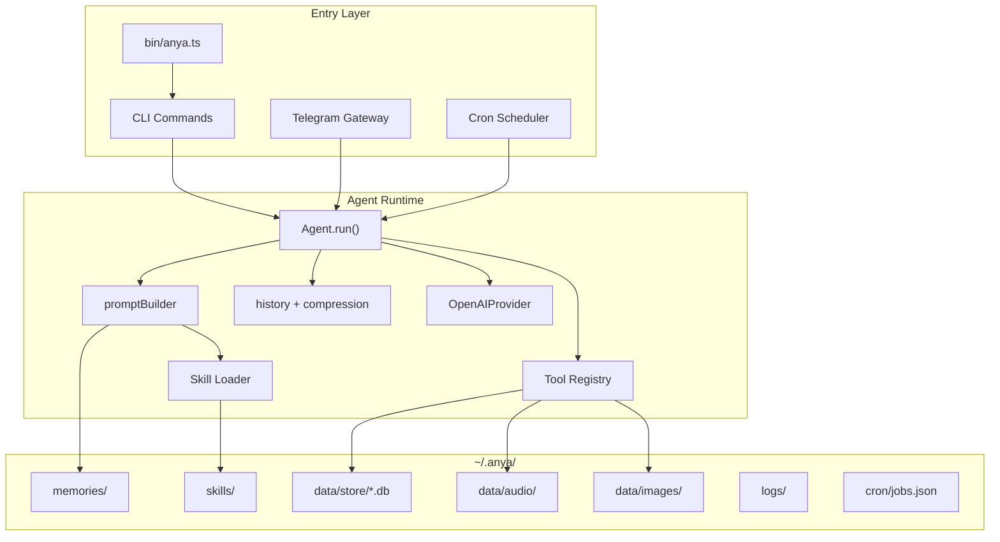

# Anya

Anya 是一个本地优先的个人 AI Agent runtime。它以 `~/.anya/` 为运行时中心，围绕统一的 `Agent.run()` 内核，提供 Telegram Bot、Cron 主动任务、Skill 驱动工作流，以及面向 IELTS 场景的成套能力。`anya chat` 目前主要用于本地 smoke test，确认链路是否打通。

当前实现重点不是“多 provider 选择器”，而是：

- **单一主 LLM 路径**：统一使用 OpenAI Codex Responses API
- **本地数据持久化**：配置、记忆、技能、数据库、日志都在 `~/.anya/`
- **Skill + Tool 架构**：用结构化 skill 描述流程，用 tool 执行动作
- **Telegram / Cron 一等公民**：适合长期运行的个人 agent

---

## 核心特性

- **统一 ReAct Agent Core**：所有入口都复用 `Agent.run()`
- **单一 OpenAI Provider**：无 provider 选择分支，默认模型为 `gpt-5.4`
- **本地 SQLite 持久化**：会话、消息、IELTS 数据全部本地保存
- **Tool Registry**：文件、Shell、网页搜索、数据库、记忆、TTS、图片生成、Telegram 富交互等能力统一暴露
- **Skill System**：skills 用 Markdown 管理，支持索引注入和按需加载
- **Telegram Runtime**：支持文本、语音、图片、按钮回调、状态消息、出站队列
- **Cron Runtime**：支持定时主动执行任务并回写 Telegram 会话历史
- **IELTS Bundled Skills**：内置听说读写、单词、daily briefing、数据库模板等完整能力集

---

## 当前架构摘要



更完整分析见：

- [`docs/architecture.md`](./docs/architecture.md)
- [`docs/architecture-diagrams.md`](./docs/architecture-diagrams.md)
- [`docs/runtime-data-layout.md`](./docs/runtime-data-layout.md)

---

## 项目定位

Anya 现在更适合被理解为：

> 一个围绕 `~/.anya/` 运转的本地 agent runtime，而不是一个只提供聊天入口的 CLI 程序。

也就是说：

- `anya chat` 仍然存在，但主要只是一个测链路是否打通的本地测试入口
- Telegram gateway 和 Cron scheduler 才是长期运行场景的核心组成部分
- provider 层不再强调“用户选哪个模型供应商”，而是默认走单一 OpenAI 路径

---

## 安装与初始化

### 环境要求

- **Node.js >= 22**
- **OpenAI / Codex 登录态**：用于 Responses API
- **Tavily API Key**：可选，用于 `web_search`
- **Telegram Bot Token**：可选，用于 Telegram gateway
- **Groq API Key**：可选，用于语音转写 STT
- **Azure Speech Key**：可选，用于发音评测等语音能力
- **Gemini API Key**：可选，仅用于图片理解/图片生成相关能力，不是主对话 provider

### 快速开始

```bash
# 安装依赖并构建
pnpm install
pnpm build

# 初始化运行时目录 ~/.anya/
anya init

# 本地测通链路
anya chat "hello"
```

初始化后会创建：

- `config.json`
- `config.schema.json`
- `memories/USER.md`
- `memories/MEMORY.md`
- `memories/RULES.md`
- `cron/jobs.json`
- `skills/.bundled/`
- `data/`、`logs/`、`run/` 等运行时目录

---

## 命令入口

当前命令入口来自 `bin/anya.ts`，核心命令包括：

```bash
anya init
anya chat <message>
anya doctor
anya config ...
anya skills ...
anya gateway ...
anya cron ...
anya sessions ...
anya usage
anya dataTransfer ...
```

说明：

- 不再以“交互式 CLI shell”作为主要产品叙事
- `chat` 当前主要用于 **本地 smoke test / 测链路是否打通**
- 长时间运行能力主要由 `gateway` 与 `cron` 提供

---

## 单一 Provider 设计

当前代码中，LLM 路径已经收敛为：

- `src/providers/openai.ts`
- `getProvider()` 恒定返回 `OpenAIProvider`

这意味着：

- 不需要 provider 选择开关
- 不需要 Gemini / OpenAI 二选一配置逻辑
- 默认主模型即 `config.provider.model`，默认值为 `gpt-5.4`

### 当前 Provider 职责边界

主 LLM 负责：

- ReAct 对话推理
- 工具调用
- 最终回答生成

Gemini 相关配置保留的意义主要是：

- 视觉分析
- 图片生成

而不是主对话 provider。

---

## 配置说明

主配置文件位于：

- `~/.anya/config.json`

关键字段：

| 字段                   | 说明                                     |
| ---------------------- | ---------------------------------------- |
| `provider.model`       | 主 LLM 模型，默认 `gpt-5.4`              |
| `provider.max_tokens`  | 最大输出 token                           |
| `provider.temperature` | 生成温度                                 |
| `provider.max_retries` | provider 调用重试次数                    |
| `tools.enabled`        | 启用的工具列表                           |
| `telegram.*`           | Telegram 网关配置                        |
| `stt.*`                | 语音转写配置                             |
| `tts.*`                | TTS 默认声音配置                         |
| `azure.*`              | Azure Speech 配置                        |
| `gemini.*`             | 图片/视觉相关配置                        |
| `advanced.*`           | 上下文窗口、压缩阈值、循环次数等高级参数 |

### 环境变量覆盖

```bash
ANYA_MODEL=gpt-5.4
ANYA_TAVILY_API_KEY=tvly-...
ANYA_TELEGRAM_BOT_TOKEN=123456:ABC...
ANYA_GEMINI_API_KEY=...
ANYA_HOME=/custom/path/.anya
```

---

## Telegram Gateway

Telegram 侧是当前最完整的平台运行形态。

支持：

- 文本消息
- 语音消息下载与 STT 转写
- 图片下载与视觉分析
- callback query
- inline keyboard / reply keyboard
- 工具执行状态消息
- 单轮出站队列串行化

### 基本启动

```bash
anya gateway start
anya gateway status
anya gateway logs -n 100
anya gateway stop
```

### 必要配置

在 `config.json` 中启用：

```json
{
  "telegram": {
    "enabled": true,
    "bot_token": "<your-bot-token>",
    "allowed_user_ids": [123456789]
  }
}
```

---

## Cron Runtime

Cron 用于主动任务执行，比如：

- 定时晨报
- IELTS 单词播种
- 周期性复习提醒
- 自动 briefing 推送

### 常见命令

```bash
anya cron list
anya cron add
anya cron run <id>
anya cron start
anya cron stop
```

Cron job 定义保存在：

- `~/.anya/cron/jobs.json`

执行历史保存在：

- `~/.anya/cron/history/`

---

## Skills System

Skill 是 Anya 的领域能力层。当前仓库里最完整的是 IELTS 系列 bundled skills。

### Skill 加载方式

1. `anya init` 把仓库中的 bundled skills 复制到 `~/.anya/skills/.bundled`
2. `loadSkills()` 递归扫描 `SKILL.md`
3. 系统 prompt 中只先注入 skill index
4. 真正执行前，再按需加载 skill 正文或附属模板/参考文件

### 典型 skill 附属资源

- `templates/*.md`
- `templates/*.sql`
- `references/*.md`
- `menu.json`

这套设计很适合像 IELTS 这种：

- 有清晰流程
- 有数据库模板
- 有固定提示格式
- 需要跨 session 持续学习的垂类场景

---

## IELTS 能力概览

当前 bundled IELTS skills 包括：

- `init`
- `words`
- `practice-reading`
- `practice-listening`
- `practice-speaking`
- `practice-writing`
- `assessment`
- `database`
- `cron-briefing`
- `cron-word-seed`
- `cron-word-review`

其中核心运行依赖通常包括：

- `memory` tool
- `db` tool
- `tts` tool
- `tg` tool
- `clarify` tool
- `pron_assess` tool

专项流程图见：[`docs/architecture-diagrams.md`](./docs/architecture-diagrams.md)

---

## 数据目录

Anya 的真正运行中心在：

- `~/.anya/`

简化结构如下：

```text
~/.anya/
├── config.json
├── config.schema.json
├── auth.json
├── memories/
├── skills/
├── cron/
├── data/
│   ├── store/
│   ├── ielts/
│   ├── search/
│   ├── audio/
│   └── images/
├── logs/
└── run/
```

详细说明见：[`docs/runtime-data-layout.md`](./docs/runtime-data-layout.md)

---

## 代码结构速览

```text
bin/                    # CLI 入口与命令包装
src/agent/              # Agent 核心、prompt、history、compression、error recovery
src/adapters/telegram/  # Telegram 网关与单轮 session adapter
src/commands/           # CLI 命令实现
src/config/             # 配置默认值、schema、loader
src/cron/               # jobs 与 scheduler
src/lib/                # paths、logger、auth、tts、stt、vision 等基础设施
src/providers/          # OpenAI provider 与 SSE/transform 实现
src/skills/             # skill loader/parser 与 bundled skills
src/storage/            # SQLite session store
src/tools/              # 所有内置工具
docs/                   # 架构与运行文档
```

---

## 开发

```bash
pnpm install
pnpm build
pnpm typecheck
pnpm test
```

开发时建议优先阅读：

1. `bin/anya.ts`
2. `src/agent/Agent.ts`
3. `src/agent/promptBuilder.ts`
4. `src/providers/openai.ts`
5. `src/tools/registry.ts`
6. `src/adapters/telegram/TelegramAdapter.ts`
7. `src/adapters/telegram/SessionAdapter.ts`
8. `src/cron/scheduler.ts`
9. `src/storage/sessionStore.ts`
10. `src/lib/paths.ts`

---

## 文档索引

- [`docs/architecture.md`](./docs/architecture.md)
- [`docs/architecture-diagrams.md`](./docs/architecture-diagrams.md)
- [`docs/runtime-data-layout.md`](./docs/runtime-data-layout.md)

如果你现在关注的是“这个项目到底怎么跑起来”，优先看：

1. `README.md`
2. `docs/architecture.md`
3. `docs/runtime-data-layout.md`
   | CLI | commander | Mature, clean API |
   | Logging | pino | Fastest JSON logger for Node |
   | Build | tsup | One-command TypeScript bundling |

## Development

```bash
# Clone
git clone https://github.com/aouos/anya.git
cd anya

# Install
pnpm install

# Build
pnpm build

# Link globally (for local testing)
pnpm link --global

# Watch mode
pnpm dev
```

## License

MIT
