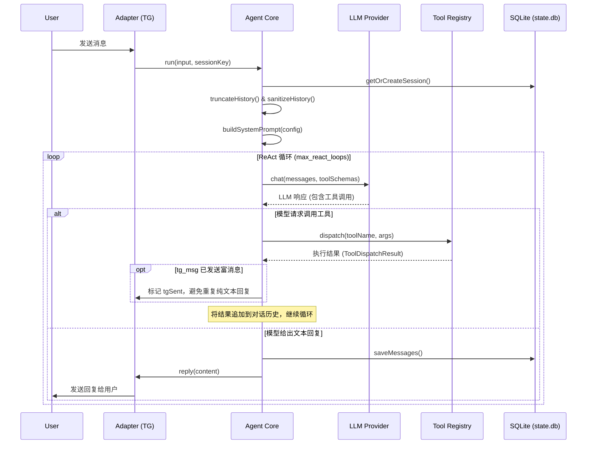

# Anya

> 用 IELTS 的优质训练内容，提升真实英语能力。

运行在 Telegram 上的陪伴式英语私教，由一个高度可定制的个人 AI Agent 框架驱动。

## 目录

- [项目定位](#项目定位)
- [核心架构与设计](#核心架构与设计)
- [个人助手边界与权限模型](#个人助手边界与权限模型)
- [Agent 能力](#agent-能力)
- [Skills 能力](#skills-能力)
- [快速上手](#快速上手)
- [外部服务与 API Key](#外部服务与-api-key)
- [开发与构建](#开发与构建)
- [Agent 数据流](#agent-数据流)
- [License](#license)

## 项目定位

Anya 不是一个简单的“刷题器”，也不应该是一个冷冰冰的“考官机器人”。

这个项目的更合理定位是：一个运行在 Telegram 上的陪伴式英语私教。它借用 IELTS 在听、说、读、写上的高质量题型设计、训练颗粒度和评分框架，但目标不是把学习者推入持续的模考、定级、算分压力，而是让学习者通过科学训练，真实地变强。

理想效果是：

- 日常体验像私教陪练，而不是考试监考
- 训练内容仍然足够专业，保留 IELTS 的方法论价值
- 英语能力先提升，考试成绩随后自然跟上
- 最终达到“无心插柳柳成荫”：不是为了分数而学，但去考也能拿高分

一句话说，这个仓库的方向应该是：

**IELTS-inspired English coaching, not IELTS-pressure machinery.**

## 核心架构与设计

Anya 采用了一个经典的 **ReAct (Reason + Act)** 循环架构，并针对长会话和稳定性做了深度优化：

1. **多层 Prompt 组装**：通过串联 Config -> SOUL (性格) -> RULES (规则) -> 记忆 (USER/MEMORY) -> 技能索引 -> 安全策略，构建了上下文极其丰富的系统提示词。
2. **状态机与平台适配**：Agent 核心与具体的通信平台解耦。Telegram 适配器不仅处理消息，还管理着复杂的交互状态（如 Pending Approvals, Quiz 轮询、并发队列）。
3. **动态技能系统 (Skills)**：使用 Markdown (`gray-matter` 解析) 定义技能，将提示词工程与代码逻辑解耦，便于非技术视角的快速迭代。
4. **上下文压缩引擎**：借鉴了 Hermes 模型的策略，保护对话头尾，对中间历史进行 LLM 总结压缩，以应对超长会话。
5. **极致的 Token 优化**：将复杂的 Telegram 交互（文本、音频、键盘等）合并为单一的 `tg_msg` 工具，大幅减少函数声明的 Token 消耗。

## 个人助手边界与权限模型

Anya 的合理安全模型不是“每一步都审批”的企业 Agent，而是一个**单用户、固定能力、固定数据目录的私人英语学习助手**。它默认只能处理自己的数据，能力边界清晰，因此日常使用不需要频繁打断用户确认。

### 设计原则

1. **数据边界固定在 `~/.anya/`**
   - `state.db`：Agent 会话、消息、工具调用、压缩上下文。
   - `study.db`：学习证据、练习记录、错因、能力分、词汇、SRS、统计快照。
   - `memories/*.md`：`SOUL.md`、`RULES.md`、`USER.md`、`MEMORY.md`。
   - `cron/jobs.json`：定时任务定义。
   - `data/audio`、`data/images`、`cron/output`：生成的音频、图片和定时任务输出。

2. **工具能力是白名单，不是开放执行环境**
   - 没有 shell 工具。
   - 没有任意代码执行工具。
   - 文件工具受 `security.allowed_paths` 限制。
   - 学习数据统一走 `persist`，skills 不直接写 `study.db`。
   - `db` 主要用于诊断；对 `study.db` 的写入被拦截。
   - Telegram 只服务 `telegram.allowed_user_ids` 中的用户；如果列表为空，表示开发期允许所有人，需要上线前收紧。

3. **审批不是主路径**
   - 默认配置是 `security.fence_mode = "deny"`，越出 `~/.anya/` 的文件访问直接拒绝。
   - 旧的 `ask` 模式仍保留，适合开发期临时调试，但不建议作为日常交互方式。
   - 对私人学习助手来说，更好的体验是“边界内自动执行，边界外直接不做”，而不是反复弹 Allow/Deny。

4. **定时任务也遵守同一边界**
   - Cron job 存在 `~/.anya/cron/jobs.json`。
   - Cron 触发时使用独立 session，不复用用户当前聊天上下文。
   - Cron 运行时会禁用 `cron`、`tg_msg`、`clarify` 这类不适合无人值守循环调用的工具，生成结果后由外层调度器统一推送。
   - Cron 输出写入 `~/.anya/cron/output/`，方便追踪和排错。

### 推荐配置

生产或长期自用时，建议保持：

```json
{
  "security": {
    "allowed_paths": ["~/.anya/"],
    "fence_mode": "deny"
  },
  "telegram": {
    "allowed_user_ids": [123456789]
  }
}
```

只有在你明确希望 Anya 读写其他目录时，才扩展 `security.allowed_paths`。不建议把项目目录、Home 目录或系统目录整体加入白名单。

## Agent 能力

Anya 的 agent core 是通用运行时，不把英语学习业务写死在核心代码里。它负责稳定地接收输入、组织上下文、调用模型、执行工具、记录会话，并把具体学习流程交给 skills。

核心能力：

- **Telegram-first 交互**：支持文本、语音、图片、按钮、quiz、force reply、message edit/delete/react，以及本地多页菜单。
- **ReAct 工具循环**：模型可以在一轮对话中多次调用工具，再基于工具结果继续推理，直到发出最终回复或 Telegram 富消息。
- **会话持久化**：`state.db` 保存 session、消息、工具调用、reasoning、错误状态和压缩后的上下文。
- **Prompt 分层**：启动时组合 `SOUL.md`、`RULES.md`、`USER.md`、`MEMORY.md`、技能索引、安全规则和平台能力。
- **长期记忆**：`USER.md` 保存用户画像和偏好，`MEMORY.md` 保存学习状态；高频训练证据不写进 markdown。
- **Typed learning persistence**：英语学习数据统一走 `persist`，写入 `study.db` 的练习、错因、词汇、SRS、计划和统计摘要。
- **语音能力**：`tts` 生成练习音频，`pron_assess` 做 Azure 发音评分，Telegram 语音可转写后进入训练流程。
- **安全边界**：文件和数据库工具默认只服务 Anya 自己的数据目录，学习数据写入不让 skills 直接 raw SQL 操作。
- **上下文控制**：长会话靠 `contextCompressor` 自动压缩，避免训练流程手动清空历史。

主要内置工具：

| 工具 | 作用 |
| --- | --- |
| `tg_msg` | 发送/编辑 Telegram 消息、按钮、语音、文件、quiz、force reply、reaction。 |
| `memory` | 读写 `USER.md` / `MEMORY.md`。 |
| `skill_view` | 读取某个 skill 的完整说明和附属文件。 |
| `persist` | 统一读写 `study.db` 的学习数据，并提供 `study_summary` / `coach_context` / session / progress snapshot 等 typed actions。 |
| `db` | 通用 SQLite 诊断工具；对 `study.db` 写入有拦截。 |
| `tts` | 生成英语/中文语音文件。 |
| `pron_assess` | 对用户语音做发音评分。 |
| `web_search` | 搜索文章、新闻和真实输入材料。 |
| `clarify` | 在需要选择时向用户发起澄清。 |
| `cron` | 管理定时任务，支持创建、暂停、恢复、删除、立即运行和列表查询。 |

## Skills 能力

Skills 是 Anya 的教学能力层。每个 skill 用 `SKILL.md` 描述触发条件、流程、按钮、数据写入和停止点；agent 通过 `skill_view` 读取后执行。这样核心 runtime 不需要知道“听写怎么评分”或“词汇复习怎么排程”，这些都留在 skills 里迭代。

当前 bundled skills 以 `english` 为集合名，保留 IELTS-style 的评分框架，但目标是提升真实英语能力。

| 能力组 | Skills | 作用 |
| --- | --- | --- |
| 入口与画像 | `planner`, `profile-manager`, `placement-quick` | 展示训练菜单、智能推荐、定时学习提醒、收集用户画像、做快速水平校准。 |
| 状态与诊断 | `learner-state`, `error-clinic` | 汇总学习数据、定期刷新能力画像和 MEMORY、解释高频错因。 |
| 听力 | `listening-dictation`, `listening-shadowing`, `listening-podcast`, `listening-numberdrill` | 精听听写、影子跟读、泛听抓主旨、数字/拼写专项。 |
| 口语 | `speaking-freetalk`, `speaking-roleplay`, `speaking-repeat`, `speaking-shadowing`, `speaking-azure-score` | 自由表达、情景对话、复述、发音门诊、Azure 评分。 |
| 阅读与输入 | `daily-article`, `material-discussion`, `reading-deepdive`, `reading-skim-drill`, `reading-typetrain` | 每日真实文章、材料讨论、精读、略读扫意、题型训练。 |
| 写作 | `writing-builder`, `writing-rewrite`, `writing-journal`, `writing-essay` | 句型构建、改写润色、低压日记、长文输出。 |
| 词汇/SRS | `vocab-harvest`, `vocab-topic`, `vocab-review`, `vocab-testme` | 从语境捕获词汇、主题词串联、间隔复习、边缘记忆抽查。 |
| 支撑资料 | `data-contract`, `band-descriptors` | 定义 `study.db` schema、persist 写入协议、错误键、评分参考。 |

数据分工：

- `state.db`：只保存 agent runtime 的会话历史。
- `study.db`：保存英语学习证据，包括学习 session、练习样本、错误、子能力分、词汇、复习记录、趋势、每日活动和周快照。
- `SOUL.md` / `RULES.md`：约束 agent 的身份、行为和工具规则。
- `USER.md` / `MEMORY.md`：给模型提供紧凑的用户画像和学习状态。

训练 skill 完成一次练习后，应通过 `persist` 写入 `samples`、`errors`、`subcap_scores`、`words` 或 `word_reviews`。学习 block 的开始/结束走 `session_start` / `session_end`。`learner-state` 通过 `coach_context` 和 `progress_snapshot` 汇总长期结论并更新 `MEMORY.md`；`planner` 基于这些数据给出智能推荐和定时提醒。

## 快速上手

### 环境要求

- Node.js **≥ 22**（依赖实验性的 `node:sqlite`）
- [pnpm](https://pnpm.io/)（仓库使用 pnpm workspace）

### 安装与初始化

```bash
pnpm install
pnpm build            # 编译到 dist/

# 初始化 ~/.anya/ 目录、默认配置和 skills 索引
node dist/bin/anya.js init
# 或者链到 PATH 后：
anya init
```

`anya init` 会在 `~/.anya/` 下生成 `config.json`、`USER.md`、`MEMORY.md`、`state.db` 等核心状态文件。

初始化后的主要目录：

```text
~/.anya/
├── config.json
├── memories/
│   ├── SOUL.md
│   ├── RULES.md
│   ├── USER.md
│   └── MEMORY.md
├── skills/
│   ├── english/
│   └── support/
└── data/
    ├── store/
    │   ├── state.db
    │   └── study.db
    ├── audio/
    └── images/
```

### 配置

编辑 `~/.anya/config.json`，最关键的几项：

- Codex OAuth —— 主 LLM 驱动
- `gemini.api_key` —— 图片/视觉能力
- `azure.speech_key` + `azure.speech_region` —— TTS 与发音评分
- `stt.groq_api_key` —— 语音识别 (可选)
- `telegram.bot_token` + `telegram.allowed_user_ids` —— Telegram Bot 接入
- `cron.enabled` + `cron.default_chat_id` —— 定时任务

可以使用 CLI 直接修改：

```bash
anya config
anya doctor              # 体检：检查环境和 API key 状态
```

### 日常运行

```bash
# 启动 Telegram Bot
anya gateway start
```

### 定时任务

Cron 是给私人助手用的轻量定时系统，不依赖系统 crontab。它通过 `anya gateway start` 启动后台 tick，默认每 60 秒检查一次 `~/.anya/cron/jobs.json`。

常用命令：

```bash
anya cron status
anya cron enable
anya cron set-chat 123456789
anya cron create --name "morning vocab" --schedule "0 8 * * *" --prompt "提醒我复习今天到期的单词"
anya cron list
anya cron pause <job_id>
anya cron resume <job_id>
anya cron run <job_id>
```

支持的 schedule：

- `30m`、`2h`、`1d`：一次性延迟任务。
- `every 30m`、`every 2h`：固定间隔任务。
- `0 8 * * *`：标准 cron 表达式。
- ISO 时间戳：例如 `2026-05-09T08:00:00+08:00`。

Cron 适合做每日复习、周复盘、学习提醒、材料准备等固定学习动作。它不适合执行需要用户当场澄清的问题；这种场景应该让任务发出简短提醒，再回到正常 Telegram 对话里完成。

## 外部服务与 API Key

| 用途           | 服务                         | 配置字段                                |
| -------------- | ---------------------------- | --------------------------------------- |
| 主 LLM + 视觉  | OpenAI / Google Gemini       | `provider.model` (及对应 provider key)  |
| TTS、发音评分  | Azure Speech                 | `azure.*`                               |
| 语音识别       | Groq Whisper / 本地          | `stt.*`                                 |
| 联网搜索       | Tavily                       | `tools.web_search.api_key`              |
| 聊天入口       | Telegram Bot                 | `telegram.*`                            |

其中 Azure、Telegram、Tavily 不配置也能跑，只是相应功能会被禁用；LLM API key 是体验完整性所需的最小集。

## 开发与构建

```bash
pnpm dev         # tsup --watch，编辑即重编译
pnpm test        # vitest 运行测试
pnpm typecheck   # TypeScript 类型检查
pnpm build       # 产出 dist/ 目录
```

代码打包由 `tsup` 驱动，采用单入口静态 import 策略，产出轻量级的命令行与核心库模块。

## Agent 数据流

Anya 的核心是一个健壮的 ReAct 循环。所有用户的消息都汇聚到 `Agent.run()`，由它统一调度系统工具、技能逻辑和本地数据库记录。



## License

MIT
