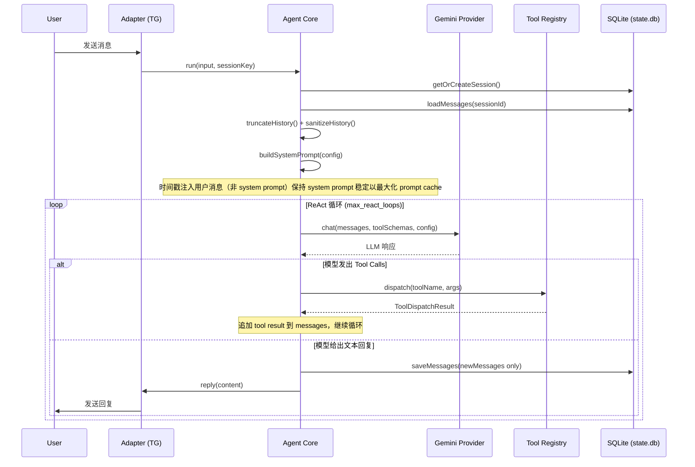

# Anya

> 用 IELTS 的优质训练内容，提升真实英语能力。

运行在 Telegram 上的陪伴式英语私教，由一个可扩展的个人 Agent 框架驱动。

## 目录

- [项目定位](#项目定位)
- [目标中的产品形态](#目标中的产品形态)
- [快速上手](#快速上手)
- [外部服务与 API Key](#外部服务与-api-key)
- [CLI 命令](#cli-命令)
- [开发](#开发)
- [Agent 架构](#agent-架构)
- [Skills 职责](#skills-职责)
- [代码结构](#代码结构)
- [数据分工](#数据分工)
- [License](#license)

## 项目定位

Anya 不是一个“刷题器”，也不应该是一个“考官机器人”。

这个项目的更合理定位是：一个运行在 Telegram 上的陪伴式英语私教。它借用 IELTS 在听、说、读、写上的高质量题型设计、训练颗粒度和评分框架，但目标不是把学习者推入持续的模考、定级、算分压力，而是让学习者通过科学训练，真实地变强。

理想效果是：

- 日常体验像私教陪练，而不是考试监考
- 训练内容仍然足够专业，保留 IELTS 的方法论价值
- 英语能力先提升，考试成绩随后自然跟上
- 最终达到“无心插柳柳成荫”：不是为了分数而学，但去考也能拿高分

## 目标中的产品形态

Anya 应该更像这样：

- 第一次进入时，先开始一小段真实练习，而不是先被“测一轮”
- 系统通过几次自然互动，逐步感知水平，而不是一次性死板定级
- 默认首页是“今天可以怎么练”，而不是“你现在几分、该走哪条路径”
- 反馈以“下一步怎么更自然、更清楚、更地道”为主，而不是“你这次是 5.5 还是 6.0”
- IELTS 被当成高质量训练素材库和能力框架，而不是项目本身的气质

一句话说，这个仓库的方向应该是：

**IELTS-inspired English coaching, not IELTS-pressure machinery.**

## 快速上手

### 环境要求

- Node.js **≥ 22**（依赖实验性的 `node:sqlite`）
- [pnpm](https://pnpm.io/)（仓库使用 pnpm workspace）
- 可选：`ffmpeg`（语音转写/合成链路用到）

### 安装与初始化

```bash
pnpm install
pnpm build            # 编译到 dist/

# 初始化 ~/.anya/ 目录、默认配置和 skills 索引
node dist/bin/anya.js init
# 或者链到 PATH 后：
anya init
```

`anya init` 会在 `~/.anya/` 下生成 `config.json`、`USER.md`、`MEMORY.md`、`state.db` 等文件。

### 配置

编辑 `~/.anya/config.json`，最关键的几项：

- `gemini.api_key` —— 主 LLM + 视觉（默认模型 `gemini-3-flash-preview`）
- `provider.model` —— 可自定义模型名称
- `azure.speech_key` + `azure.speech_region` —— TTS 与发音评分
- `stt.groq_api_key` —— 语音识别
- `telegram.bot_token` + `telegram.allowed_user_ids` —— Telegram Bot 接入
- `tools.web_search.api_key` —— Tavily 联网搜索

也可以用 CLI 直接改：

```bash
anya config get
anya config set gemini.api_key sk-...
anya doctor              # 体检：检查 Node、ffmpeg、API key、数据库
```

### 日常运行

```bash
# 启动 Telegram Bot
anya gateway start

# 查看会话历史 / 本月 API 用量
anya sessions list
anya usage
```

## 外部服务与 API Key

| 用途           | 服务                         | 配置字段                                |
| -------------- | ---------------------------- | --------------------------------------- |
| 主 LLM + 视觉  | Google Gemini（AI Studio）   | `gemini.api_key` + `provider.model`     |
| TTS、发音评分  | Azure Speech                 | `azure.*`                               |
| 语音识别       | Groq Whisper                 | `stt.groq_api_key`                      |
| 联网搜索       | Tavily                       | `tools.web_search.api_key`              |
| 聊天入口       | Telegram Bot                 | `telegram.*`                            |

其中 Azure、Telegram、Tavily 不配置也能跑，只是相应功能会被禁用；Gemini API key 是体验完整性所需的最小集。

## CLI 命令

所有命令都以 `anya` 为入口（对应 [bin/anya.ts](bin/anya.ts)）：

| 命令                                          | 作用                                                                    |
| --------------------------------------------- | ----------------------------------------------------------------------- |
| `anya init`                                   | 初始化 `~/.anya/` 与默认配置                                            |
| `anya config <get\|set\|edit\|path>`          | 读写 `config.json`                                                      |
| `anya doctor`                                 | 环境体检（Node、ffmpeg、API、DB）                                       |
| `anya skills <list\|install\|remove\|reload>` | 管理本地与打包 skills                                                   |
| `anya gateway <start\|stop\|status>`          | Telegram Bot 网关                                                       |
| `anya sessions <list\|show\|delete>`          | 会话历史存档（SQLite）                                                  |
| `anya export <file>`                          | 把 `~/.anya/` 打包成 tar.gz                                             |
| `anya usage`                                  | 计费型服务的月度用量                                                    |

## 开发

```bash
pnpm dev         # tsup --watch，编辑即重编译
pnpm test        # vitest run
pnpm test:watch  # vitest 监听模式
pnpm typecheck   # tsc --noEmit
pnpm build       # 产出 dist/
```

打包由 [tsup.config.ts](tsup.config.ts) 驱动，采用单入口静态 import 策略，产物只有 3 个文件：`dist/bin/anya.js`（CLI）+ `dist/index.js`（可编程 API）+ `dist/index.d.ts`（类型声明）。[scripts/postbuild.cjs](scripts/postbuild.cjs) 负责加 shebang 和修正 `node:sqlite` import。

## Agent 架构与数据流

Anya 采用统一 Agent Core 架构，所有消息入口最终都汇聚到 `Agent.run()`，由其统一调度工具、技能和本地数据，所有运行态数据都落在 `~/.anya/`。

**数据流游泳池（Swimlane）图：**



### 架构分层与职责

- **Entry / Process Layer**：`bin/anya.ts` 负责系统命令（CLI）与网关的启动分发。
- **Command Layer**：`src/commands/` 提供命令实现。
- **Adapter Layer**：`src/adapters/telegram/` 等将平台输入/输出转为统一格式。
- **Agent Core Layer**：`src/agent/Agent.ts` 统一 ReAct 循环、prompt 组装、历史管理、工具调度、消息落库。
- **Provider Layer**：`src/providers/gemini.ts` 目前唯一主 LLM Provider。
- **Tool & Skill Layer**：`src/tools/`、`src/skills/` 注册原子工具与领域技能。
- **Storage / Runtime Foundation Layer**：`src/storage/`、`src/lib/paths.ts` 等统一路径、SQLite、日志、配置。
- **Bundled Domain Assets Layer**：`src/skills/bundled/ielts/**` 提供 IELTS 能力跃迁系统。

### 运行时数据目录结构

所有运行态数据均存于 `~/.anya/`，结构如下：

```text
~/.anya/
├── config.json
├── config.schema.json
├── memories/
│   ├── RULES.md
│   ├── USER.md
│   └── MEMORY.md
├── skills/
│   └── .bundled/
│   ├── jobs.json
│   └── history/
├── data/
│   ├── store/
│   │   ├── state.db          # 会话与消息历史
│   │   └── *.db              # vocab.db / learner.db 等由 db tool 按需创建
│   ├── search/
│   ├── cache/
│   ├── audio/
│   │   ├── voice/
│   │   └── tts/
│   └── images/
│       └── received/
├── logs/
└── run/
```

### 设计理念（核心摘录）

> Anya 不是“刷题器”或“考官机器人”，而是以 IELTS 优质训练内容为基础，打造低压力、长期主义、真实有效的英语成长系统。所有能力都围绕“陪伴式私教”体验设计，IELTS 只是方法论和素材库。

---

## Skills 技能包

共几十个 skill，覆盖建档、定级、四科训练、词汇 SRS、诊断分析、教练等。所有 skill 定义在 `src/skills/bundled/`。

```
用户消息 → Agent → ielts-router → 具体 skill
                                      ↓
                                  study.db (写入练习数据)
                                      ↓
                            用户手动触发 → learner-state → MEMORY.md (聚合刷新)
```

### 🔧 系统

| Skill | 说明 |
|-------|------|
| `profile-manager` | 建档与资料更新。首次运行收集用户目标、背景、偏好，写入 USER.md |
| `ielts-router` | 训练中心主菜单。解析自由文本练习请求，路由到对应 skill |
| `placement-quick` | 10 分钟快速定级：口语 30s + 听写 2 句 + 阅读 150 词 + 写作 50 词 |

### 🗣️ 口语 Speaking

| Skill | 说明 |
|-------|------|
| `speaking-freetalk` | **即兴脱口秀与辩论**：不再是单向独白，Anya 会主动抛出暴论或追问，倒逼用户即兴反驳 |
| `speaking-repeat` | 听后复述：播放片段一次，用自己的话复述 |
| `speaking-roleplay` | 场景对话（机场/餐厅/面试/诊所），Anya 扮演对方 |
| `speaking-shadowing` | 语音跟读与发音门诊：精准评估发音，并提供发音器官级（舌头、口型）的物理纠音指导 |
| `speaking-azure-score` | [内部] Azure 发音评估接口封装，被其他口语 skill 调用 |

### 🎧 听力 Listening

| Skill | 说明 |
|-------|------|
| `listening-dictation` | 句子听写：盲听 → 提示 → 逐词 diff → 中文释义 → 重做 |
| `listening-shadowing` | 片段级影子跟读：节奏 + 关键词保留 + 语调捕捉 |
| `listening-numberdrill` | 数字/日期/时间/拼写专项（13 vs 30、double-0、人名拼写） |
| `listening-podcast` | **播客泛听浸泡**：不要求做题，训练在长程真实语料中抓取大意和猜测语境的能力 |

### 📖 阅读 Reading

| Skill | 说明 |
|-------|------|
| `daily-article` | **每日文章精读**：抓取用户感兴趣的新闻或话题生成适配水平的文章，生成音频并伴随核心生词静默入库 |
| `material-discussion` | **真实外刊闲聊**：抓取用户感兴趣的真实新闻/帖子，不强做题，只为引发全英文自由讨论 |
| `reading-deepdive` | **核心外刊精读**：无时间压力，深度解剖长难句语法结构和段落逻辑 |
| `reading-skim-drill` | 90 秒略读后隐藏文章，凭记忆回答主旨 + 功能题 |
| `reading-vocab-extract` | 阅读后词汇收割：提取生词/短语/释义对存入 study.db |

### ✍️ 写作 Writing

| Skill | 说明 |
|-------|------|
| `writing-journal` | **英语日记/碎碎念**：提供情绪价值的低压力练笔出口，带隐性语法和地道表达润色 |
| `writing-essay` | 长文综合写作：合并了书信、图表和议论文的综合长段落训练入口 |
| `writing-rewrite` | 升级改写：把 Band 5/6 段落改到 Band 7 水平 |
| `writing-builder` | **句法构造工厂**：一站式微观训练，包含高级词汇造句、句型转换、结构扩写 |

### 📚 词汇 Vocabulary

| Skill | 说明 |
|-------|------|
| `vocab-review` | **SRS 记忆引擎**：Anki 级按遗忘曲线复习。遮挡释义盲猜，带词根拆解与地道俚语平替 |
| `vocab-harvest` | **全局生词收割机**：在听说读写中自动提取您的薄弱表达，或通过对话主动将生词加入您的私人词库 |
| `vocab-testme` | 主动回忆测验：针对临界掌握词汇 |
| `vocab-topic` | 主题聚类学习：一个话题 8-12 个词，展示 → 隐藏 → 回忆 |

### 📊 诊断与分析

| Skill | 说明 |
|-------|------|
| `learner-state` | **数据驱动的水平刷新**。查询 study.db 最近 14 天数据，EMA 平滑计算 bands，写入 MEMORY.md |
| `error-clinic` | **全科错题门诊**：统一接管听说读写的错题分析，直击语法或认知陷阱，给出避坑 Tips |

### 💬 教练 Coaching

| Skill | 说明 |
|-------|------|
| `coach-consultation` | **教练进度复盘**：用户的战略顾问，整合进度、弱点分析和下一步建议，自然对话输出 |
| `coach-proactive` | 主动教练：根据触发条件决定是否提醒、鼓励或刷新学习计划 |

### 📦 支撑包 Support

| Skill | 说明 |
|-------|------|
| `ielts-band-descriptors` | 官方雅思评分标准：四科 band descriptors + raw-to-band 换算表 |
| `ielts-data-contract` | study.db 规范：schema、查询模板、post-practice 写入协议 |

## 代码结构

- [bin/](bin/)
  CLI 外壳。`anya.ts` 是入口，通过 commander 注册并管理所有的命令行子命令。
- [src/agent/](src/agent/)
  Agent 主循环、prompt 拼装、上下文压缩、历史管理、错误分类器。
- [src/providers/](src/providers/)
  LLM provider 抽象，当前只有 Gemini 实现。
- [src/adapters/telegram/](src/adapters/telegram/)
  Telegram Bot、菜单、语音/图片消息接入。
- [src/tools/](src/tools/)
  Agent 可调用的工具：`db`、`memory`、`file`、`skill`、`clarify`、`tts`、`pron_assess`、`web_search`、`telegram`、`reset_context`，以及 `registry` 负责装配。
- [src/commands/](src/commands/)
  CLI 命令实现（config / gateway / usage 等）。
- [src/config/](src/config/)
  配置默认值、JSON schema、loader。
- [src/storage/](src/storage/)
  `db` 基础连接 + `sessionStore` 会话/消息档案。
- [src/lib/](src/lib/)
  通用库：paths、pidfile、ffmpeg、stt、tts、tgFormat、logger、usage、approval。
- [src/skills/bundled/](src/skills/bundled/)
  IELTS 技能包（上述 50 个 skill）。
  调度器 + 默认任务。

## 数据分工

### 数据文件

| 文件 | 说明 |
|------|------|
| `USER.md` | 稳定用户档案：身份、目标、兴趣、学习偏好。由 `profile-manager` 管理 |
| `MEMORY.md` | 派生学习状态：IELTS bands、weak dimensions、adaptive controls。**由 study.db 数据聚合驱动**，通过 `learner-state` 技能按需刷新 |
| `study.db` | **唯一的练习事实数据库**。所有练习记录、错误、词汇、进度都存在这里 |
| `state.db` | Agent 会话历史和消息存档 |

### 数据职责

- 练习 skill 只写 `study.db`，不直接改 `MEMORY.md`
- `learner-state` 每日聚合 study.db → EMA 平滑 → 刷新 MEMORY.md
- 训练难度由 `MEMORY.md` 驱动，skill 读取后自适应

### study.db 表结构

Schema 定义在 `src/skills/bundled/support/ielts-data-contract/templates/study.sql`。

#### 练习与评估

| 表 | 说明 |
|----|------|
| `samples` | **每次练习的核心记录**。skill_type、band 四维评分、时长、难度、mode（study/exam/placement） |
| `errors` | **每次练习的具体错误**。关联 sample_id，带 recurrence_key（追踪高频错误）、类别、严重度 |
| `subcap_scores` | **子能力评分**。如 `speaking.fluency = 5.5`。用于弱点定位 |
| `sample_words` | 练习中涉及的词汇（曝光/使用） |
| `mock_sessions` | **完整考试记录**。placement / mock 的四科 band + 稳定性评分 |

#### 词汇与 SRS

| 表 | 说明 |
|----|------|
| `words` | **词汇本**。释义、中文、IPA、例句、音频。SRS：mastery、间隔、ease、到期。5 种 item_kind |
| `word_events` | 词汇事件日志。每次复习/查询/使用一行 |
| `paraphrase_groups` | 同义替换分组，按话题聚类 |
| `paraphrase_members` | 同义替换组成员词，带语域标注 |

#### 任务与进度

| 表 | 说明 |
|----|------|
| `daily_tasks` | **每日任务清单**。手动触发生成，标记完成状态 |
| `band_trend` | **每日 band 趋势**。每天每科一行，由 learner-state 写入 |
| `activity_log` | **每日活动汇总**。会话数、总时长、涉及科目、复习词数 |
| `stage_transitions` | 学习阶段变迁记录 |

#### Mastery 生命周期

```
queued_new → learning → known → mastered
```

#### Transfer Level（迁移层级）

```
0 seeded → 1 seen → 2 active-check pass → 3 spoke → 4 wrote
```

## 总结

Anya 最有前途的地方，不是把 IELTS 做得更像考试，而是把 IELTS 的优质训练方法，做成一个**纯粹、低压力、长期主义**、真实有效的**英语私教**系统。我们已经去除了所有笨重的全真模考和奇葩题型，只保留最核心的能力训练。

如果这个方向成立，那么高分不会消失，只是它不再被放在学习体验的正中央。
