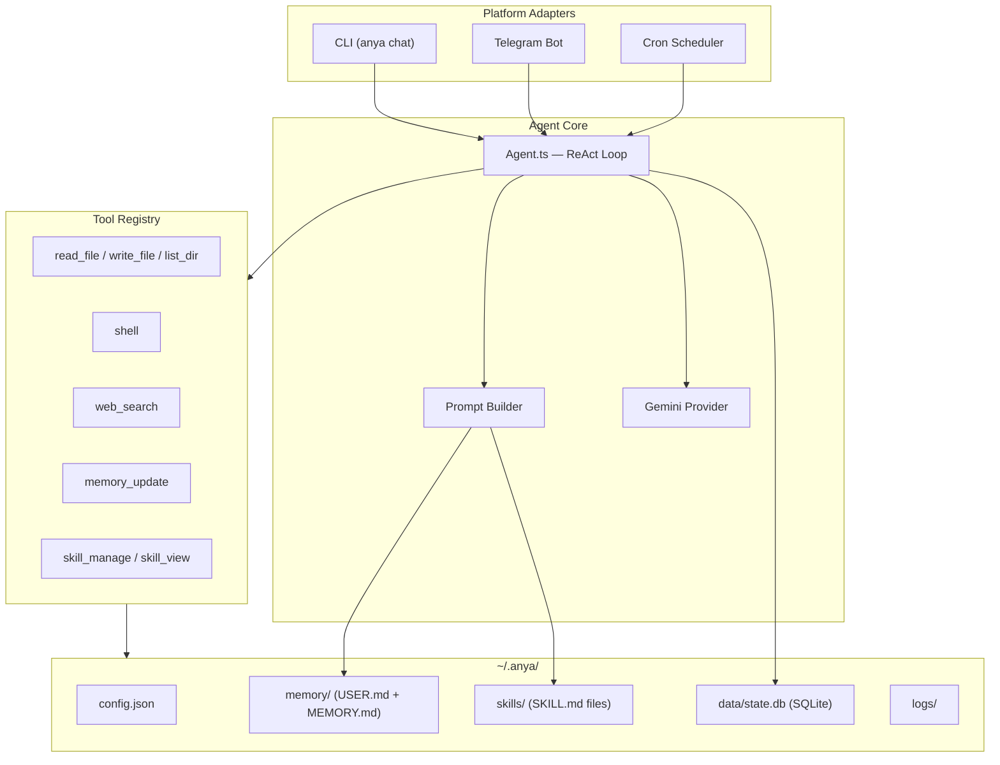
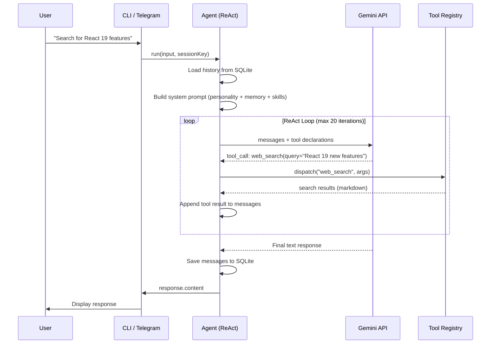
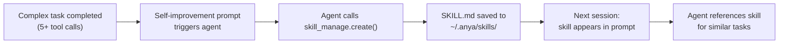

# Anya

A self-evolving personal AI agent. Named after the Anya constellation — an agent that navigates autonomously.

Anya is a minimalist but fully-featured personal AI agent built with TypeScript. It combines a ReAct reasoning loop, tool system, self-improving skills, and multi-platform support into a single CLI tool, with all user data living in one folder (`~/.anya/`).

## Features

- **ReAct Loop** — Iterative reasoning: the agent thinks, acts (calls tools), observes results, and repeats
- **8 Built-in Tools** — File read/write, shell commands, web search, memory, skill management
- **Skills System** — Agent learns from complex tasks and saves reusable procedures as Markdown skills
- **Multi-Platform** — CLI REPL + Telegram bot, same agent core
- **Cron Jobs** — Schedule tasks (e.g. "daily news summary sent to Telegram")
- **Soul/Environment Separation** — Migrate your agent's memory and skills to a new machine with one command
- **Directory Fence** — File access outside `~/.anya/` requires your approval
- **Session History** — Conversations persisted in SQLite, searchable

## Architecture



### Request Flow



### Skills Evolution



## Quick Start

```bash
# 1. Install globally
npm install -g anya
# or: pnpm add -g anya

# 2. Initialize (interactive setup)
anya init
# → Creates ~/.anya/ directory structure
# → Asks for Gemini API key (required, free from https://aistudio.google.com)
# → Optionally configure Tavily key (for web search) and Telegram bot

# 3. Start chatting
anya chat
```

### Requirements

- **Node.js >= 22** (uses built-in `node:sqlite`)
- **Gemini API Key** — Free from [Google AI Studio](https://aistudio.google.com)
- **Tavily API Key** *(optional)* — Free tier from [tavily.com](https://tavily.com) for web search
- **Telegram Bot Token** *(optional)* — From [@BotFather](https://t.me/BotFather) for Telegram integration

## Usage

### CLI Chat

```bash
# Interactive REPL
anya chat

# Single question (exits after response)
anya chat -q "What is the capital of France?"

# New session (ignore previous history)
anya chat --new
```

### Commands

```bash
anya init                     # Setup wizard
anya chat [options]           # Interactive chat
anya doctor                   # Check environment health
anya config show              # View configuration (API keys masked)
anya config edit              # Open config.json in $EDITOR

anya skills list              # List installed skills
anya skills view <name>       # View skill details
anya skills create <name>     # Create a skill template

anya gateway start            # Start Telegram bot
anya gateway stop             # Stop Telegram bot
anya gateway status           # Check bot status
anya gateway logs [-n 100]    # View bot logs

anya cron list                # List scheduled jobs
anya cron add                 # Add a job (interactive)
anya cron remove <id>         # Remove a job
anya cron run <id>            # Run a job manually
anya cron start               # Start scheduler
anya cron stop                # Stop scheduler

anya sessions list            # List recent sessions
anya sessions search <query>  # Search messages

anya export backup.tar.gz         # Full backup
anya export --soul soul.tar.gz    # Soul layer only
anya import backup.tar.gz         # Restore from backup
```

## Telegram Setup

1. **Create a bot** — Talk to [@BotFather](https://t.me/BotFather) on Telegram, send `/newbot`, follow the prompts. You'll get a bot token like `123456:ABC-DEF...`.

2. **Get your user ID** — Talk to [@userinfobot](https://t.me/userinfobot) on Telegram, it will reply with your numeric user ID.

3. **Configure Anya** — Either run `anya init` and enter the token when prompted, or edit the config directly:

```bash
anya config edit
```

Set these fields in `config.json`:

```json
{
  "telegram": {
    "enabled": true,
    "bot_token": "123456:ABC-DEF1234ghIkl-zyx57W2v1u123ew11",
    "allowed_user_ids": [YOUR_USER_ID]
  }
}
```

4. **Start the gateway**:

```bash
anya gateway start
```

5. **Talk to your bot** in Telegram. It responds using the same agent core as `anya chat`.

> **Security**: Only users in `allowed_user_ids` can interact with the bot. All other messages are ignored.

## Configuration

All configuration lives in `~/.anya/config.json`. The file has an associated JSON Schema for VS Code autocompletion.

### Key Settings

| Setting | Default | Description |
|---------|---------|-------------|
| `provider.primary` | `gemini-2.5-flash` | LLM model to use |
| `provider.api_key` | — | Gemini API key |
| `provider.temperature` | `0.7` | Response randomness (0-1) |
| `provider.max_tokens` | `8192` | Max output tokens |
| `tools.enabled` | All tools | Which tools the agent can use |
| `tools.shell.require_approval` | `true` | Require approval for shell commands |
| `tools.shell.approval_allowlist` | `git status`, `ls`, etc. | Commands that skip approval |
| `tools.web_search.api_key` | — | Tavily API key |
| `security.fence_mode` | `ask` | `ask` / `allow` / `deny` for out-of-fence access |
| `security.allowed_paths` | `["~/.anya/"]` | Paths the agent can access without approval |

### Environment Variables

Override any config with env vars:

```bash
ANYA_GEMINI_API_KEY=AIza...    # Override provider.api_key
ANYA_TAVILY_API_KEY=tvly-...   # Override tools.web_search.api_key
ANYA_HOME=/custom/path          # Override ~/.anya/ location
```

## Data Directory

Everything lives in `~/.anya/`:

```
~/.anya/
├── config.json              # All settings
├── config.schema.json       # JSON Schema (VS Code autocompletion)
│
│ ── Soul Layer (migrate with your agent) ──
├── memory/
│   ├── USER.md              # What the agent knows about you
│   └── MEMORY.md            # Agent's own notes and context
├── skills/                  # Learned procedures (SKILL.md files)
├── cron/jobs.json           # Scheduled task definitions
│
│ ── Environment Layer (can be rebuilt) ──
├── data/state.db            # SQLite (sessions + messages)
├── logs/                    # JSON logs (pino)
└── run/                     # PID files for background services
```

### Migration

```bash
# Export soul (memory + skills + config) to a new machine
anya export --soul anya-soul.tar.gz

# On the new machine
anya import anya-soul.tar.gz
# Agent arrives with all its memories and skills intact
```

## Skills System

Skills are Markdown files that teach the agent reusable procedures. The agent creates them automatically after complex tasks, or you can create them manually.

### Example Skill

```markdown
---
name: react-debug
description: Debug React component rendering issues
version: 1.0.0
tags: [react, debugging]
category: frontend
---

# When to Use
When a React component doesn't render or state updates seem broken.

# Procedure
1. Read the component source with read_file
2. Check useEffect dependency arrays
3. Look for direct state mutations
4. Search for known React version bugs if needed

# Pitfalls
- Don't suggest adding key prop without confirming it's a list issue
- React 18+ strict mode runs useEffect twice — this is normal
```

### Progressive Disclosure

Skills load in 3 levels to conserve tokens:

| Level | Trigger | Content | Tokens |
|-------|---------|---------|--------|
| L0 | Auto (system prompt) | Name + description of all skills | ~2k |
| L1 | Agent calls `skill_view(name)` | Full SKILL.md body | varies |
| L2 | Agent calls `skill_view(name, file)` | Attached templates/scripts | varies |

## Tech Stack

| Component | Choice | Why |
|-----------|--------|-----|
| Language | TypeScript 5.x | Type safety |
| Runtime | Node.js >= 22 | Built-in SQLite, native fetch |
| LLM | Google Gemini | Free API key, function calling |
| Database | `node:sqlite` | Zero dependencies, built into Node |
| Telegram | grammy | Modern, TypeScript-native |
| CLI | commander | Mature, clean API |
| Logging | pino | Fastest JSON logger for Node |
| Build | tsup | One-command TypeScript bundling |

## Development

```bash
# Clone
git clone https://github.com/aouos/anya.git
cd anya

# Install
pnpm install

# Build
pnpm build

# Link globally (for local testing)
pnpm link --global

# Watch mode
pnpm dev
```

## License

MIT
