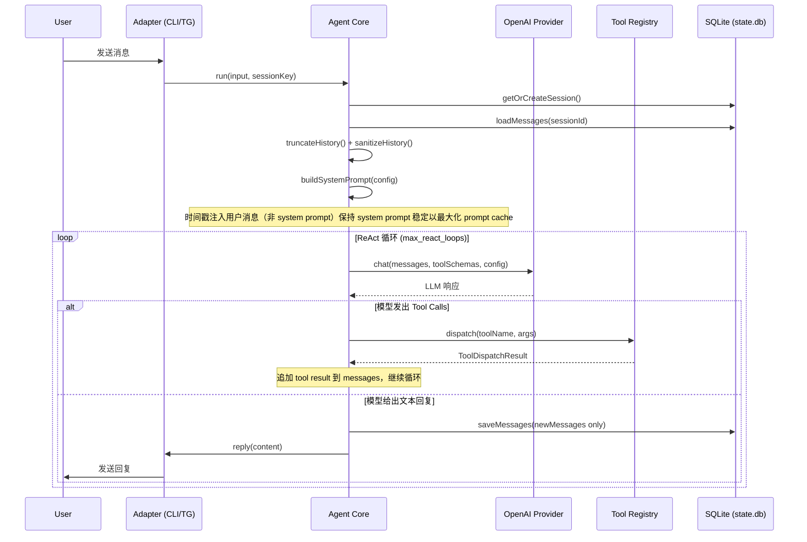

# Anya

> 用 IELTS 的优质训练内容，提升真实英语能力。

运行在 Telegram / CLI 上的陪伴式英语私教，由一个可扩展的个人 Agent 框架驱动。

## 目录

- [项目定位](#项目定位)
- [目标中的产品形态](#目标中的产品形态)
- [快速上手](#快速上手)
- [外部服务与 API Key](#外部服务与-api-key)
- [CLI 命令](#cli-命令)
- [开发](#开发)
- [Agent 架构](#agent-架构)
- [Skills 职责](#skills-职责)
- [代码结构](#代码结构)
- [数据分工](#数据分工)
- [License](#license)

## 项目定位

Anya 不是一个“刷题器”，也不应该是一个“考官机器人”。

这个项目的更合理定位是：一个运行在 Telegram 上的陪伴式英语私教。它借用 IELTS 在听、说、读、写上的高质量题型设计、训练颗粒度和评分框架，但目标不是把学习者推入持续的模考、定级、算分压力，而是让学习者通过科学训练，真实地变强。

理想效果是：

- 日常体验像私教陪练，而不是考试监考
- 训练内容仍然足够专业，保留 IELTS 的方法论价值
- 英语能力先提升，考试成绩随后自然跟上
- 最终达到“无心插柳柳成荫”：不是为了分数而学，但去考也能拿高分

## 目标中的产品形态

Anya 应该更像这样：

- 第一次进入时，先开始一小段真实练习，而不是先被“测一轮”
- 系统通过几次自然互动，逐步感知水平，而不是一次性死板定级
- 默认首页是“今天可以怎么练”，而不是“你现在几分、该走哪条路径”
- 反馈以“下一步怎么更自然、更清楚、更地道”为主，而不是“你这次是 5.5 还是 6.0”
- IELTS 被当成高质量训练素材库和能力框架，而不是项目本身的气质

一句话说，这个仓库的方向应该是：

**IELTS-inspired English coaching, not IELTS-pressure machinery.**

## 快速上手

### 环境要求

- Node.js **≥ 22**（依赖实验性的 `node:sqlite`）
- [pnpm](https://pnpm.io/)（仓库使用 pnpm workspace）
- 可选：`ffmpeg`（语音转写/合成链路用到）

### 安装与初始化

```bash
pnpm install
pnpm build            # 编译到 dist/

# 初始化 ~/.anya/ 目录、默认配置和 skills 索引
node dist/bin/anya.js init
# 或者链到 PATH 后：
anya init
```

`anya init` 会在 `~/.anya/` 下生成 `config.json`、`USER.md`、`MEMORY.md`、`state.db` 等文件。

### 配置

编辑 `~/.anya/config.json`，最关键的几项：

- `provider.model` —— 主 LLM（默认 OpenAI Codex `gpt-5.4`，通过 `anya gateway` 做 OAuth 设备码登录）
- `gemini.api_key` —— 视觉 / 图像生成
- `azure.speech_key` + `azure.speech_region` —— TTS 与发音评分
- `stt.groq_api_key` —— 语音识别
- `telegram.bot_token` + `telegram.allowed_user_ids` —— Telegram Bot 接入
- `tools.web_search.api_key` —— Tavily 联网搜索

也可以用 CLI 直接改：

```bash
anya config get
anya config set gemini.api_key sk-...
anya doctor              # 体检：检查 Node、ffmpeg、API key、数据库
```

### 日常运行

```bash
# 单次对话（CLI）
anya chat "帮我练一组雅思口语 Part 2"

# 启动 Telegram Bot
anya gateway start

# 查看 / 管理定时任务（每日 briefing、词汇推送、assessment 同步）
anya cron list
anya cron enable daily-briefing

# 查看会话历史 / 本月 API 用量
anya sessions list
anya usage
```

## 外部服务与 API Key

| 用途           | 服务                         | 配置字段                                |
| -------------- | ---------------------------- | --------------------------------------- |
| 主 LLM         | OpenAI Codex（OAuth 设备码） | `provider.model` + `anya gateway login` |
| 视觉、图像生成 | Google Gemini（AI Studio）   | `gemini.*`                              |
| TTS、发音评分  | Azure Speech                 | `azure.*`                               |
| 语音识别       | Groq Whisper                 | `stt.groq_api_key`                      |
| 联网搜索       | Tavily                       | `tools.web_search.api_key`              |
| 聊天入口       | Telegram Bot                 | `telegram.*`                            |

其中 Azure、Telegram、Tavily 不配置也能跑，只是相应功能会被禁用；主 LLM 与 Gemini 是体验完整性所需的最小集。

## CLI 命令

所有命令都以 `anya` 为入口（对应 [bin/anya.ts](bin/anya.ts)）：

| 命令                                          | 作用                                                                    |
| --------------------------------------------- | ----------------------------------------------------------------------- |
| `anya init`                                   | 初始化 `~/.anya/` 与默认配置                                            |
| `anya chat [msg]`                             | 单次对话                                                                |
| `anya config <get\|set\|edit\|path>`          | 读写 `config.json`                                                      |
| `anya doctor`                                 | 环境体检（Node、ffmpeg、API、DB）                                       |
| `anya skills <list\|install\|remove\|reload>` | 管理本地与打包 skills                                                   |
| `anya gateway <start\|login\|status>`         | Telegram Bot / OAuth 会话                                               |
| `anya cron <list\|enable\|disable\|run>`      | 定时任务（见 [src/cron/default_jobs.json](src/cron/default_jobs.json)） |
| `anya sessions <list\|show\|delete>`          | 会话历史存档（SQLite）                                                  |
| `anya export <file>`                          | 把 `~/.anya/` 打包成 tar.gz                                             |
| `anya usage`                                  | 计费型服务的月度用量                                                    |

## 开发

```bash
pnpm dev         # tsup --watch，编辑即重编译
pnpm test        # vitest run
pnpm test:watch  # vitest 监听模式
pnpm typecheck   # tsc --noEmit
pnpm build       # 产出 dist/
```

打包由 [tsup.config.ts](tsup.config.ts) 驱动，采用单入口静态 import 策略，产物只有 3 个文件：`dist/bin/anya.js`（CLI）+ `dist/index.js`（可编程 API）+ `dist/index.d.ts`（类型声明）。[scripts/postbuild.cjs](scripts/postbuild.cjs) 负责加 shebang 和修正 `node:sqlite` import。

## Agent 架构与数据流

Anya 采用统一 Agent Core 架构，所有入口（CLI/Telegram/Cron）最终都汇聚到 `Agent.run()`，由其统一调度工具、技能和本地数据，所有运行态数据都落在 `~/.anya/`。

**数据流游泳池（Swimlane）图：**



### 架构分层与职责

- **Entry / Process Layer**：`bin/anya.ts` 负责 CLI/网关/定时任务分发。
- **Command Layer**：`src/commands/` 提供命令实现。
- **Adapter Layer**：`src/adapters/telegram/` 等将平台输入/输出转为统一格式。
- **Agent Core Layer**：`src/agent/Agent.ts` 统一 ReAct 循环、prompt 组装、历史管理、工具调度、消息落库。
- **Provider Layer**：`src/providers/openai.ts` 目前唯一主 LLM Provider。
- **Tool & Skill Layer**：`src/tools/`、`src/skills/` 注册原子工具与领域技能。
- **Storage / Runtime Foundation Layer**：`src/storage/`、`src/lib/paths.ts` 等统一路径、SQLite、日志、配置。
- **Bundled Domain Assets Layer**：`src/skills/bundled/ielts/**` 提供 IELTS 能力跃迁系统。

### 运行时数据目录结构

所有运行态数据均存于 `~/.anya/`，结构如下：

```text
~/.anya/
├── config.json
├── config.schema.json
├── auth.json
├── memories/
│   ├── RULES.md
│   ├── USER.md
│   └── MEMORY.md
├── skills/
│   └── .bundled/
├── cron/
│   ├── jobs.json
│   └── history/
├── data/
│   ├── store/
│   │   ├── state.db          # 会话与消息历史
│   │   └── *.db              # vocab.db / learner.db 等由 db tool 按需创建
│   ├── search/
│   ├── cache/
│   ├── audio/
│   │   ├── voice/
│   │   └── tts/
│   └── images/
│       ├── received/
│       └── generated/
├── logs/
└── run/
```

### 设计理念（核心摘录）

> Anya 不是“刷题器”或“考官机器人”，而是以 IELTS 优质训练内容为基础，打造低压力、长期主义、真实有效的英语成长系统。所有能力都围绕“陪伴式私教”体验设计，IELTS 只是方法论和素材库。

---

## Skills 职责

当前真正可用、带 `SKILL.md` 的 IELTS skills 有这些：

- `init`
  首次 onboarding。收集最小用户档案，做轻量水平校准，写入 `USER.md` / `MEMORY.md`，然后把用户送进训练菜单。
- `practice`
  训练总入口。负责展示训练菜单，把用户路由到听说读写或词汇模块。
- `practice-writing`
  写作训练。负责 brainstorming、TEEL、sentence-lab、full-task、rewrite loop、错误记录和写作样本落库。
- `practice-speaking`
  口语训练。负责 shadowing、guided QA、cue card、role-play、retell、发音反馈和口语样本落库。
- `practice-reading`
  阅读训练。负责 flash-skim、sentence anatomy、argument map、attitude scan、ext-reading 和阅读样本落库。
- `practice-listening`
  听力训练。负责 sound drill、dictation、short clip、question type、note-taking、ext-listening 和听力样本落库。
- `words`
  词汇系统。负责 lookup、learn、review、chunk/pattern/paraphrase group、SRS 事件和 `vocab.db` 更新。
- `assessment`
  专门的学习数据分析器。它负责读取 `learner.db` 里的最近练习数据，重新估算 band、weak dimensions、profile，并更新 `MEMORY.md`。
- `database`
  数据层参考 skill。提供 `learner.db` / `vocab.db` 的 schema 和常用 SQL 写法，方便其他 skill 一致地读写数据库。
- `cron-briefing`
  每日学习推送。根据当前 band、薄弱项、兴趣和近期学习状态生成 briefing、文章、音频和轻量 follow-up。
- `cron-word-seed`
  静默词库补货。根据当前水平往 `vocab.db` 里补 `queued_new` 词项。
- `cron-word-review`
  每日单词复习推送。只推已经进入学习系统的词，不引入未学新词。

## 代码结构

- [bin/](bin/)
  CLI 外壳。`anya.ts` 是入口，`bin/commands/*.ts` 用 commander 注册各子命令，仅负责参数解析和输出格式化。
- [src/index.ts](src/index.ts)
  可编程 API 导出（`Agent`、`loadConfig`、`registerTool` 等），供外部项目 `import` 使用。
- [src/agent/](src/agent/)
  Agent 主循环、prompt 拼装（`promptBuilder`）、上下文引擎与压缩（`contextEngine` / `contextCompressor`）、历史管理、错误分类器。
- [src/providers/](src/providers/)
  LLM provider 抽象，当前只有 OpenAI Codex 实现。
- [src/adapters/telegram/](src/adapters/telegram/)
  Telegram Bot、菜单、语音/图片消息接入。
- [src/tools/](src/tools/)
  Agent 可调用的工具：`db`、`memory`、`file`、`shell`、`skill`、`clarify`、`tts`、`pron_assess`、`web_search`、`image_gen`、`telegram`，以及 `registry` 负责装配。
- [src/commands/](src/commands/)
  CLI 命令的真正实现（`runInit` / `runChat` / `runConfigMenu` / `runGatewayStart-Stop-Status-Logs` / `runUsage`），供 [bin/](bin/) 调用。
- [src/config/](src/config/)
  配置默认值、JSON schema、loader，以及 `RULES.template.md`（写入 `~/.anya/memories/`）。
- [src/storage/](src/storage/)
  `db` 基础连接 + `sessionStore` 会话/消息档案。
- [src/lib/](src/lib/)
  通用库：`paths`（`ANYA_HOME` 等路径）、`auth`（Codex OAuth）、`pidfile`（守护进程）、`ffmpeg`、`stt`、`tts`、`vision`、`tgFormat`、`logger`、`usage`、`approval`。
- [src/skills/bundled/ielts/init/](src/skills/bundled/ielts/init/)
  初始化、用户档案、轻量水平校准。
- [src/skills/bundled/ielts/practice/](src/skills/bundled/ielts/practice/) 及 `practice-*`
  训练总入口 + 听说读写四项训练技能。
- [src/skills/bundled/ielts/words/](src/skills/bundled/ielts/words/)
  词汇与词块系统。
- [src/skills/bundled/ielts/assessment/](src/skills/bundled/ielts/assessment/)
  学习数据分析，重算 band / weak dimensions，回写 `MEMORY.md`。
- [src/skills/bundled/ielts/database/](src/skills/bundled/ielts/database/)
  `learner.db` / `vocab.db` 的 schema 与查询参考。
- [src/cron/](src/cron/)
  调度器 + 默认任务（`default_jobs.json`），目前负责每日 briefing、词汇补货和词汇复习推送。
- [scripts/postbuild.cjs](scripts/postbuild.cjs)
  打包后处理：为 `dist/bin/anya.js` 加 shebang，修正 `node:sqlite` import。

## 数据分工

项目里最重要的几个数据面分别是：

- `USER.md`
  稳定用户档案：身份、目标、兴趣、学习偏好。
- `MEMORY.md`
  派生学习状态：IELTS bands、weak dimensions、adaptive controls、profile blocks。这个文件不是手工评分表，而是训练控制面板。
- `learner.db`
  练习事实数据：`samples`、`errors`、`subcap_scores` 等。这里存原始训练证据。
- `vocab.db`
  词汇与 SRS 数据：`words`、`word_events`、`paraphrase_groups` 等。
- `state.db`
  Agent 会话历史和消息存档。

当前推荐的数据职责是：

- 练习 skill 只写 `learner.db` / `vocab.db`
- `assessment` 专门分析数据库并更新 `MEMORY.md`
- 训练难度由 `MEMORY.md` 驱动，而不是每个 skill 各自维护一套水平状态

## 总结

Anya 最有前途的地方，不是把 IELTS 做得更像考试，而是把 IELTS 的优质训练方法，做成一个低压力、长期主义、真实有效的英语成长系统。

如果这个方向成立，那么高分不会消失，只是它不再被放在学习体验的正中央。
