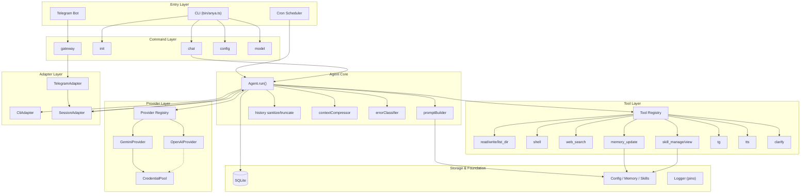
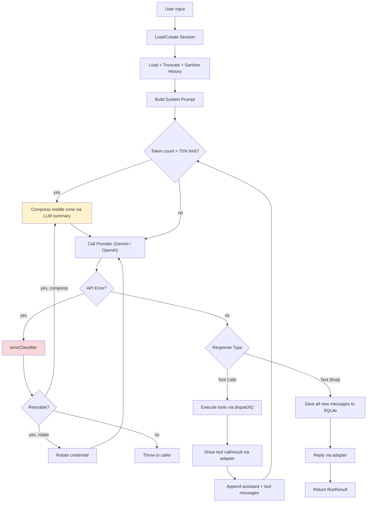
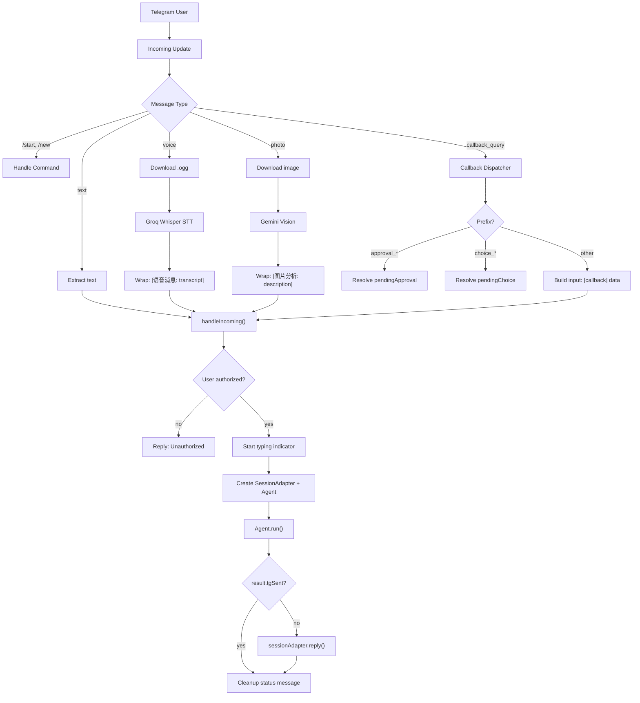
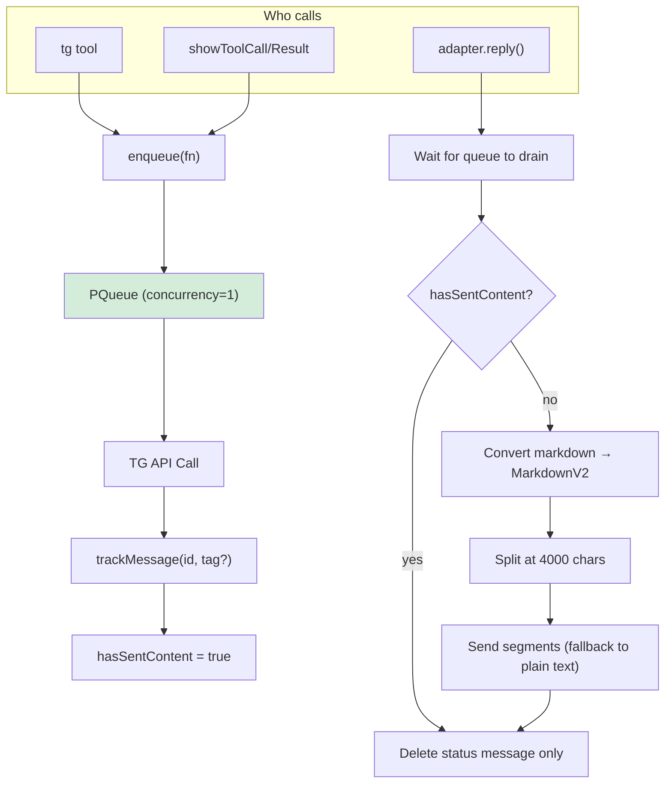
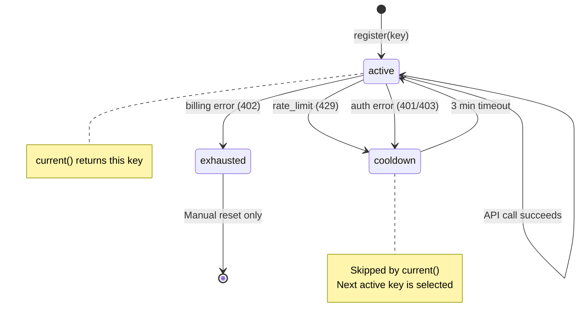
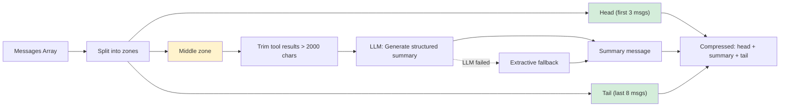
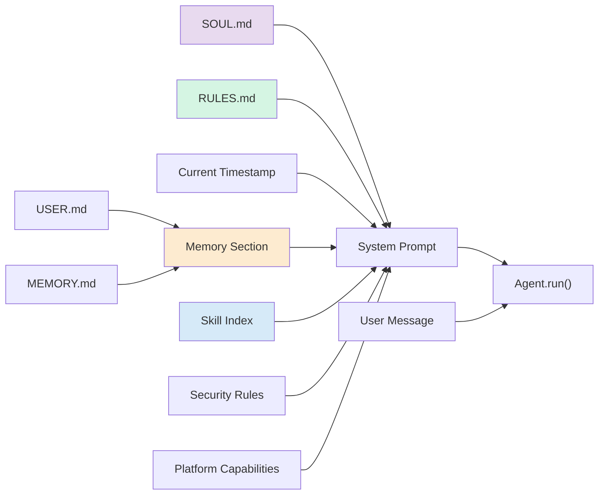
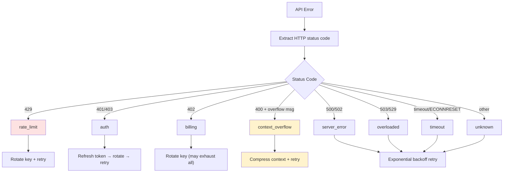
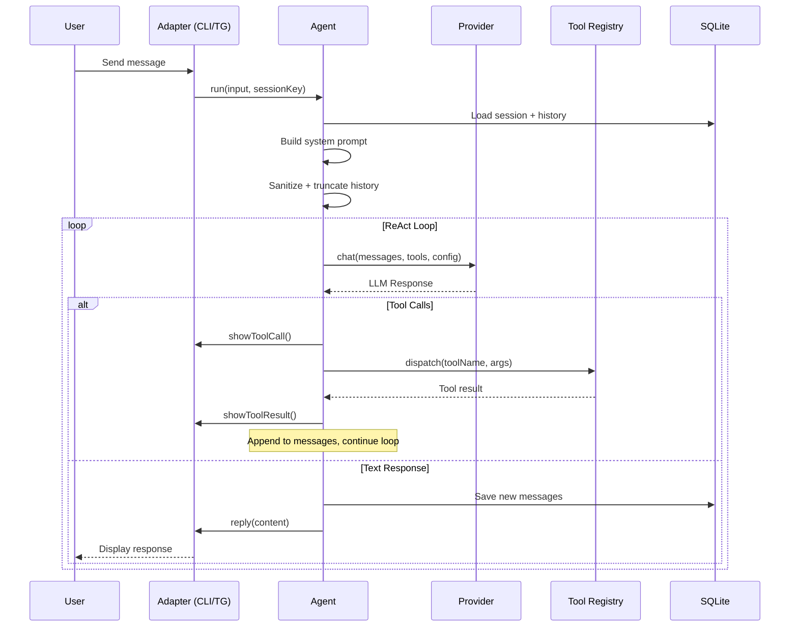

# Architecture Diagrams

本文档包含 Anya 的架构图和流程图，配合 [architecture.md](./architecture.md) 阅读。

---

## 1. 系统总体架构



---

## 2. ReAct 循环流程



---

## 3. Telegram 消息处理流程



---

## 4. SessionAdapter 出站队列



---

## 5. Credential Pool 轮换



---

## 6. Context Compression 流程



---

## 7. Prompt 组装



---

## 8. Error Recovery 策略



---

## 9. 数据流：从用户输入到最终回复



---

## 10. 目录结构与模块关系

```
src/
├── agent/                  # Agent 核心
│   ├── Agent.ts            # ReAct 循环主体
│   ├── types.ts            # Message, Adapter, ToolDefinition 等类型
│   ├── promptBuilder.ts    # System Prompt 组装
│   ├── history.ts          # 截断 + Gemini 格式清洗
│   ├── contextCompressor.ts # LLM 摘要压缩
│   ├── contextEngine.ts    # 压缩引擎接口
│   └── errorClassifier.ts  # API 错误分类
│
├── providers/              # LLM Provider 层
│   ├── base.ts             # LLMProvider 接口
│   ├── registry.ts         # model → provider 路由
│   ├── gemini.ts           # Gemini SDK 实现
│   ├── openai.ts           # OpenAI Codex SSE 实现
│   ├── openai/             # OpenAI 子模块 (retry, stream, transform)
│   └── credentialPool.ts   # 多 key 轮换池
│
├── tools/                  # 工具层
│   ├── registry.ts         # 注册 + 分发
│   ├── fileTools.ts        # 文件系统
│   ├── shellTool.ts        # 命令执行
│   ├── webSearch.ts        # Tavily 搜索
│   ├── memoryTools.ts      # 长期记忆
│   ├── skillTools.ts       # Skill CRUD
│   ├── telegramTools.ts    # TG 统一交互
│   ├── tts.ts              # 文本转语音
│   └── clarifyTools.ts     # 用户选择
│
├── adapters/               # 平台适配
│   ├── base.ts             # 抽象基类
│   ├── cli.ts              # CLI REPL
│   └── telegram/           # Telegram 适配
│       ├── TelegramAdapter.ts   # Bot 生命周期
│       ├── SessionAdapter.ts    # Per-turn 队列
│       ├── markdown.ts          # Markdown 分割/剥离
│       ├── errors.ts            # 错误格式化
│       └── types.ts             # TG 类型定义
│
├── config/                 # 配置系统
│   ├── defaults.ts         # AnyaConfig 接口 + 默认值
│   ├── schema.ts           # Zod 校验 schema
│   └── loader.ts           # 三层 merge (defaults + file + env)
│
├── storage/                # 持久化
│   ├── db.ts               # SQLite 单例 (WAL mode)
│   └── sessionStore.ts     # Session/Message CRUD
│
├── lib/                    # 基础设施
│   ├── paths.ts            # 所有文件路径常量
│   ├── logger.ts           # pino 结构化日志
│   ├── approval.ts         # 路径沙箱 + 命令审批
│   ├── auth.ts             # OpenAI OAuth Device Grant
│   ├── stt.ts              # Groq Whisper STT
│   ├── tts.ts              # Edge TTS + ffmpeg 转码
│   ├── vision.ts           # Gemini Vision
│   ├── tgFormat.ts         # Markdown → MarkdownV2
│   └── pidfile.ts          # 进程管理 PID 文件
│
├── skills/                 # Skill 系统
│   ├── loader.ts           # 加载 + 缓存 + index 生成
│   └── parser.ts           # YAML frontmatter 解析
│
├── cron/                   # 定时任务
│   ├── jobs.ts             # Job 定义 + CRUD
│   └── scheduler.ts        # croner 调度器
│
├── commands/               # CLI 命令
│   ├── chat.ts             # 交互式聊天
│   ├── init.ts             # 初始化向导
│   ├── model.ts            # 模型切换
│   ├── gateway.ts          # TG bot 进程管理
│   └── config/             # 配置子命令
│
└── index.ts                # 公共 API 导出
```
