# Architecture Diagrams

本文档基于当前源码实现，展示真实的数据流、模块关系和关键运行流程。

阅读建议：图上方的说明解释这张图在讲什么，节点名对应源码中的模块/函数名，按"输入 → 处理 → 输出"去看。

---

## 1. 总体架构

**一句话理解：所有入口（CLI/Telegram）最终都汇聚到 `Agent.run()`，统一调度工具、技能和本地数据，所有运行态数据落在 `~/.anya/`。**

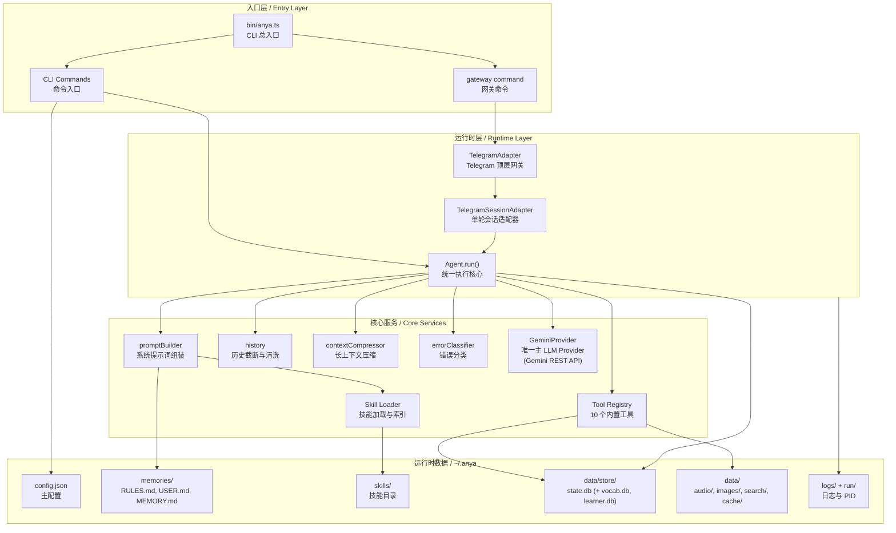

---

## 2. 游泳池数据流：从用户输入到最终回复

**本图展示全链路：用户输入 → Adapter → Agent → Provider → Tools → SQLite → 最终回复。**

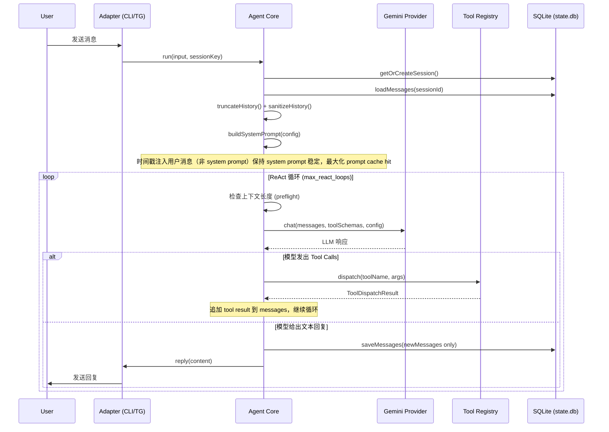

---

## 3. CLI 启动与命令分发

**用户敲 `anya ...` 以后，命令是怎么被分发到具体实现的。长期交互依靠 `gateway`。**

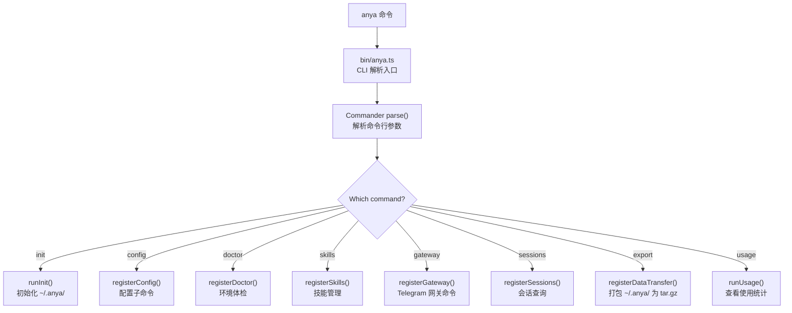

---

## 4. Agent ReAct 主循环

**这是系统最核心的一张图，描述 `Agent.run()` 如何反复调用模型、执行工具、再继续推理。**

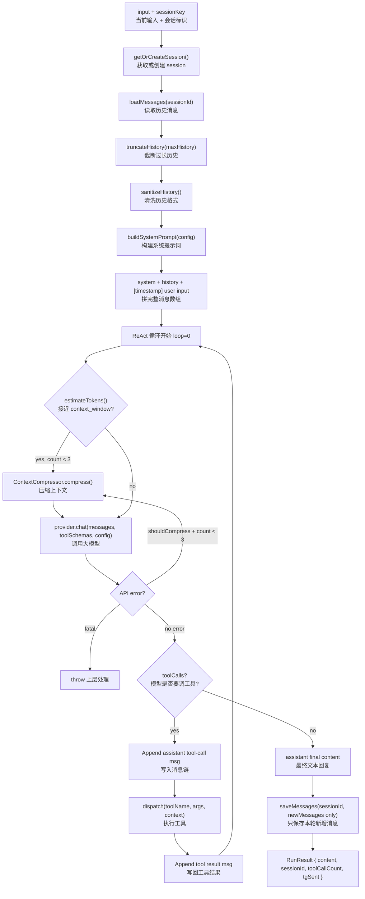

---

## 5. System Prompt 组装

**每次 `Agent.run()` 开始时，system prompt 的构建顺序（来自 `promptBuilder.ts`）。**

注意：时间戳被放入用户消息而非 system prompt，以保持 system prompt 稳定，最大化 Gemini 的 prompt cache 命中率。

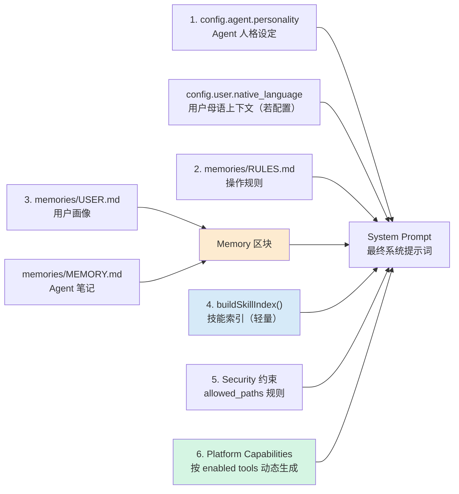

---

## 6. Tool Registry 与执行链

**tool 如何注册、模型如何看见、`dispatch()` 如何执行。**

当前内置工具：`file`、`webSearch`、`memory`、`skill`、`clarify`、`telegram`、`tts`、`pronAssess`、`db`、`resetContext` 等。

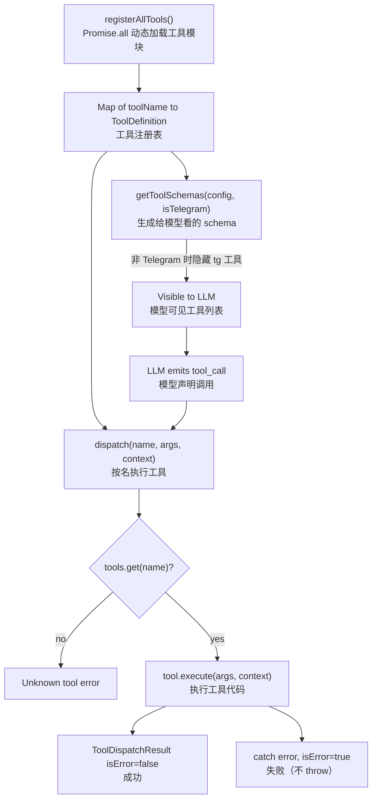

---

## 7. Telegram 网关处理流程

**TelegramAdapter 收到不同类型消息后的处理链路。每个 chat 有独立的串行队列（chatQueue），防止同一会话并发竞争。**

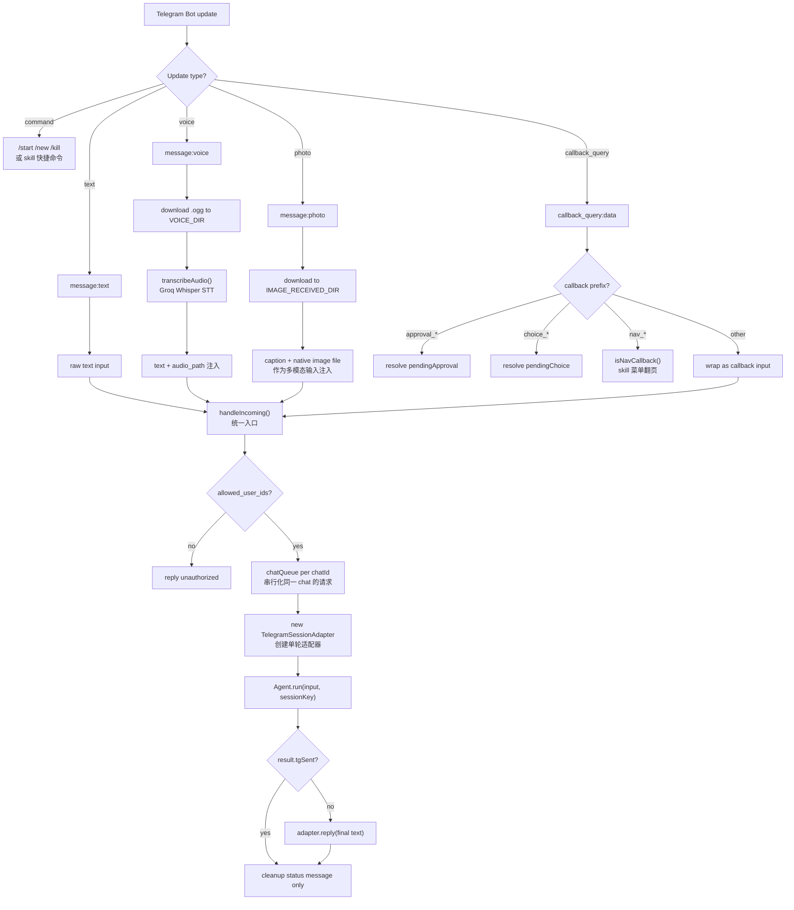

---

## 8. TelegramSessionAdapter 出站串行化

**为什么 Telegram 发消息不会乱序，以及 tool 发过消息后最终 reply 不会重复。**

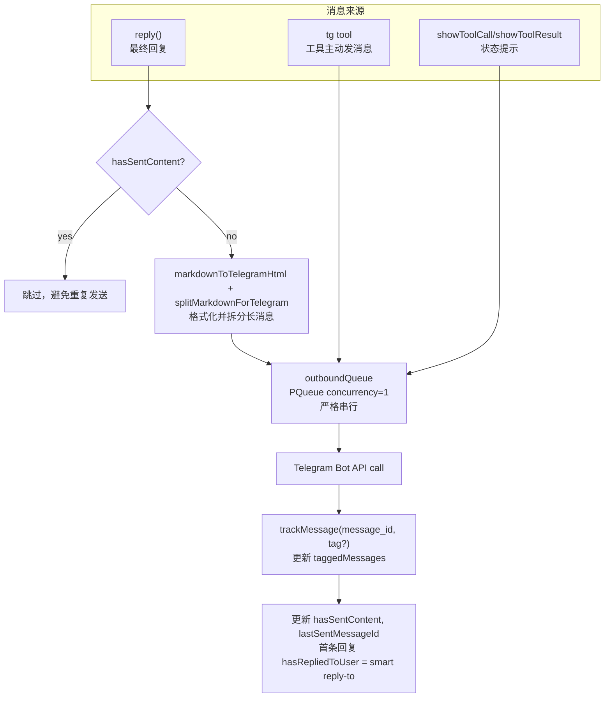

---

## 9. 配置加载机制

**配置是三层叠加：内置默认值 → 用户配置文件 → 环境变量，最终产出单例。**

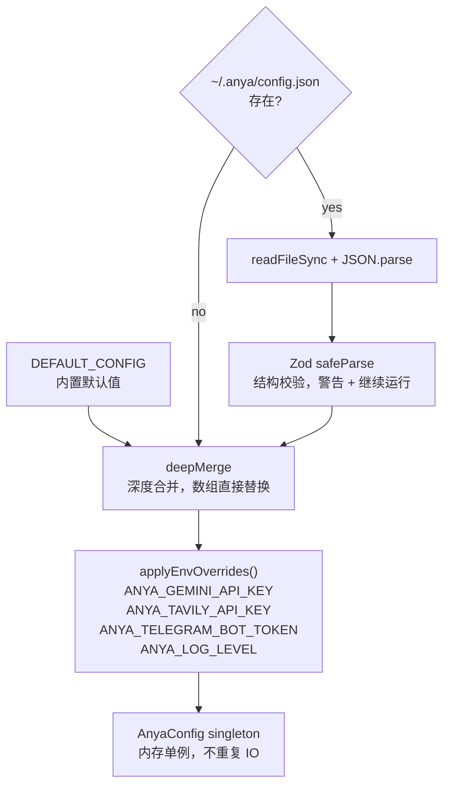

---

## 10. 会话持久化模型

**一轮 Agent 执行结束后，消息如何落到 SQLite。只写本轮新增消息，不重写全量历史。**

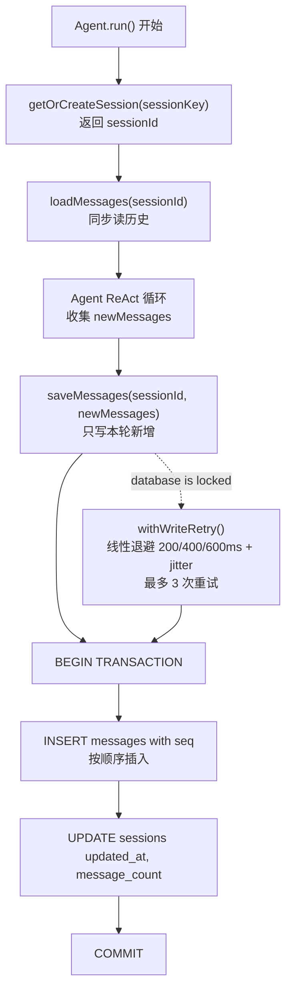

---

## 11. Skill 加载与使用路径

**skill 从 bundled 资产 → 用户目录 → 扫描索引 → 注入 prompt → 按需加载全文的完整路径。**

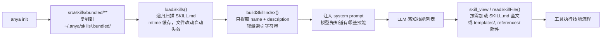

---

## 12. 运行时数据目录结构

**`~/.anya/` 完整目录布局，来自 `src/lib/paths.ts` 定义。**

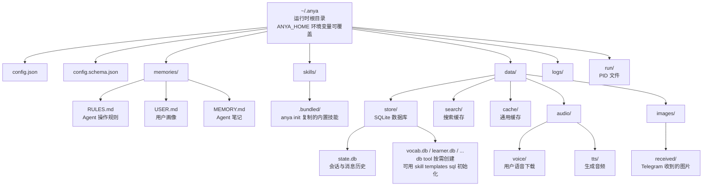
