# Architecture Diagrams

本文档按当前源码实现更新，展示真实的数据流、模块关系和关键运行流程。

配合 [`architecture.md`](./architecture.md) 阅读。

阅读建议：

- 每张图上方先看「这张图在讲什么」
- 再看图里的英文节点名，它们基本都对应源码里的模块/函数名
- 如果英文不直观，我已经在每张图下面补了中文解释，按“输入 → 处理 → 输出”去看就行

---

## 1. 当前总体架构

**这张图在讲什么：**

- 最上层是进程/命令入口
- 中间是运行时核心：Agent、Telegram、Cron
- 再下面是核心服务：Prompt、Provider、Tools、Skills
- 最下面是 `~/.anya/` 运行时数据

```text
一句话理解：不同入口最终都会汇聚到 Agent，再去调用工具、技能和本地数据。
```

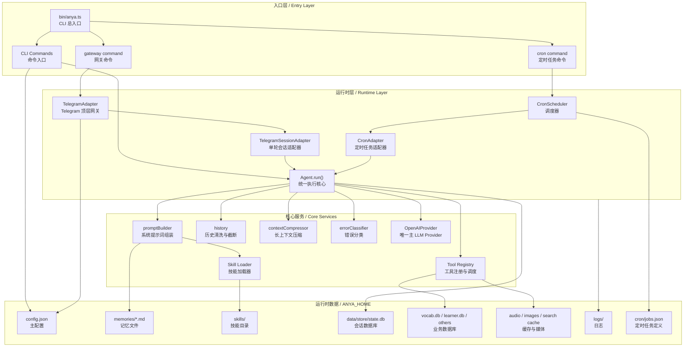

**怎么看：**

- `bin/anya.ts` 是所有命令的入口
- 真正干活的是 `Agent.run()`
- `Agent.run()` 依赖 Prompt、Provider、Tools、Skills
- 所有长期状态最终都落到 `~/.anya/` 里

---

## 2. CLI 启动与命令分发

**这张图在讲什么：**

- 用户敲 `anya ...` 以后，命令是怎么被分发到具体实现的
- 这里的 `chat` 不代表主产品入口，只是本地 smoke test 路径

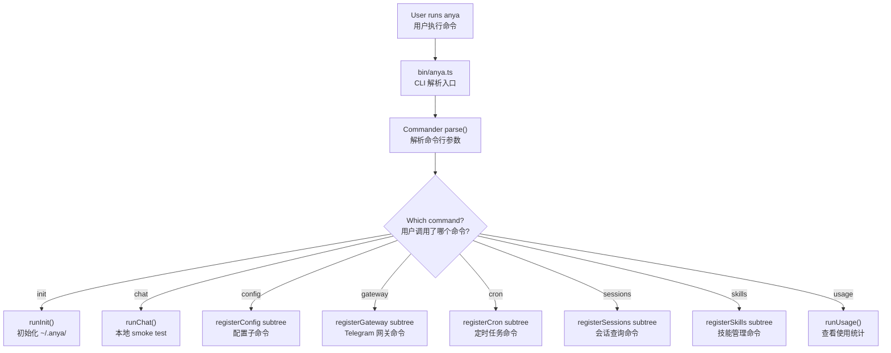

**怎么看：**

- `init` 是初始化环境
- `chat` 只是本地快速测试链路
- 真正长期运行主要是 `gateway` 和 `cron`

---

## 3. Agent ReAct 主循环

**这张图在讲什么：**

- 这是整个系统最核心的一张图
- 它描述 `Agent.run()` 每次接到输入后，如何反复调用模型、执行工具、再继续推理

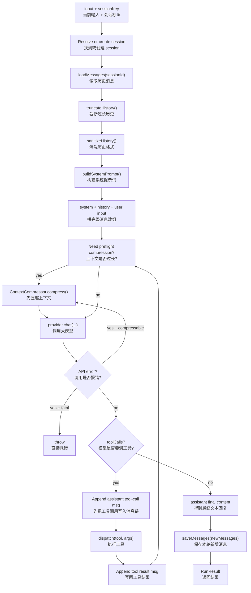

**怎么看：**

- 如果模型要调用工具，就不会立刻结束
- 工具结果会回写消息链，再继续问模型
- 直到模型给出真正最终答案，才结束这一轮

---

## 4. System Prompt 组装

**这张图在讲什么：**

- 每次 `Agent.run()` 开始时，system prompt 是由哪些部分拼起来的

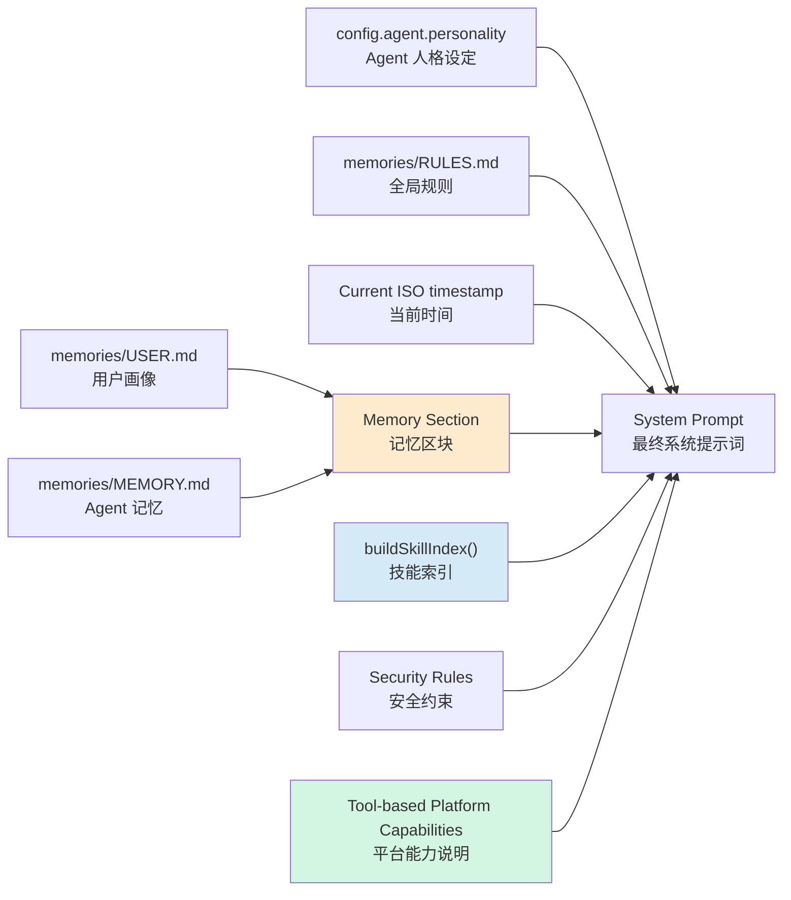

**怎么看：**

- Prompt 不是只靠一段固定 system message
- 它是把人格、规则、时间、记忆、技能索引、安全策略拼出来的

---

## 5. Tool Registry 与执行链

**这张图在讲什么：**

- tool 是怎么注册进去的
- 模型看见 tool schema 后，如何真正调用到本地代码

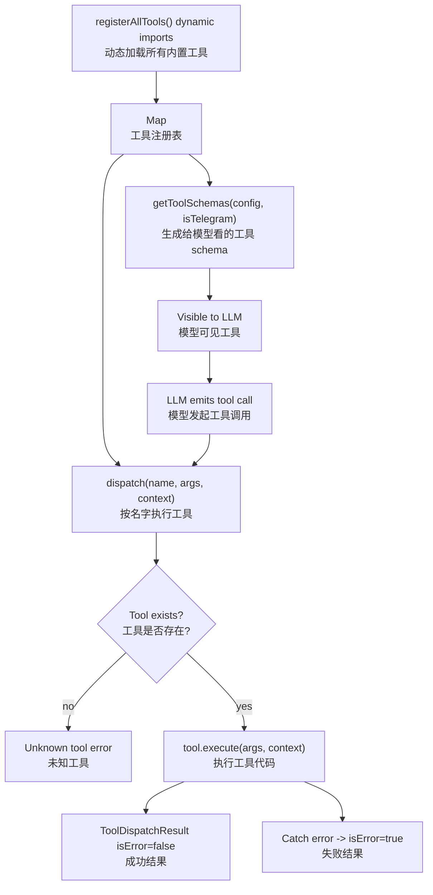

**怎么看：**

- 模型不会直接执行本地代码
- 它只能“声明想调哪个工具”
- 真正执行动作的是 `dispatch()`

---

## 6. Telegram 网关处理流程

**这张图在讲什么：**

- Telegram 收到不同类型消息后，如何被包装成 Agent 输入

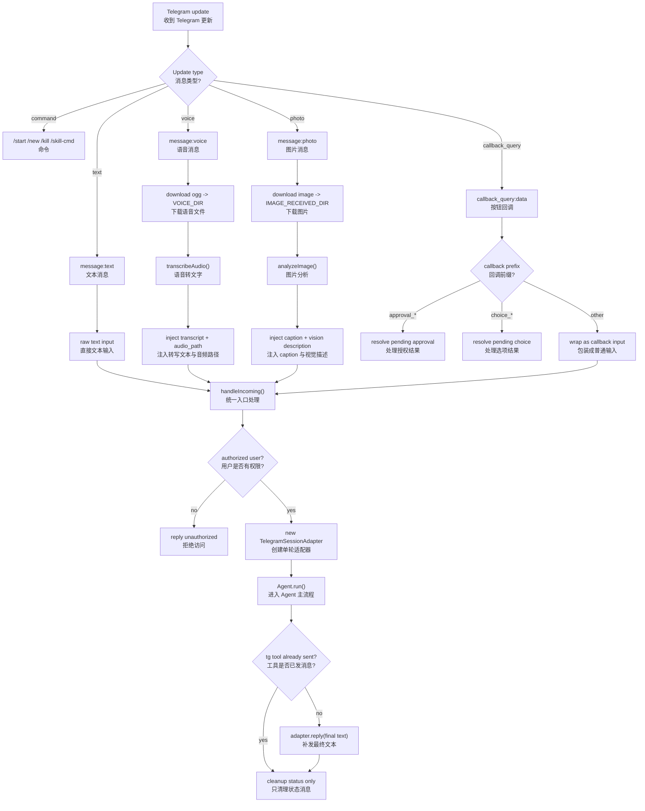

**怎么看：**

- Telegram 不同类型输入，最后都会被转换成字符串上下文
- 然后统一喂给 `Agent.run()`

---

## 7. TelegramSessionAdapter 出站串行化

**这张图在讲什么：**

- 为什么 Telegram 发消息不会乱序
- 为什么 tool 发过消息后，最终 reply 不会重复发一遍

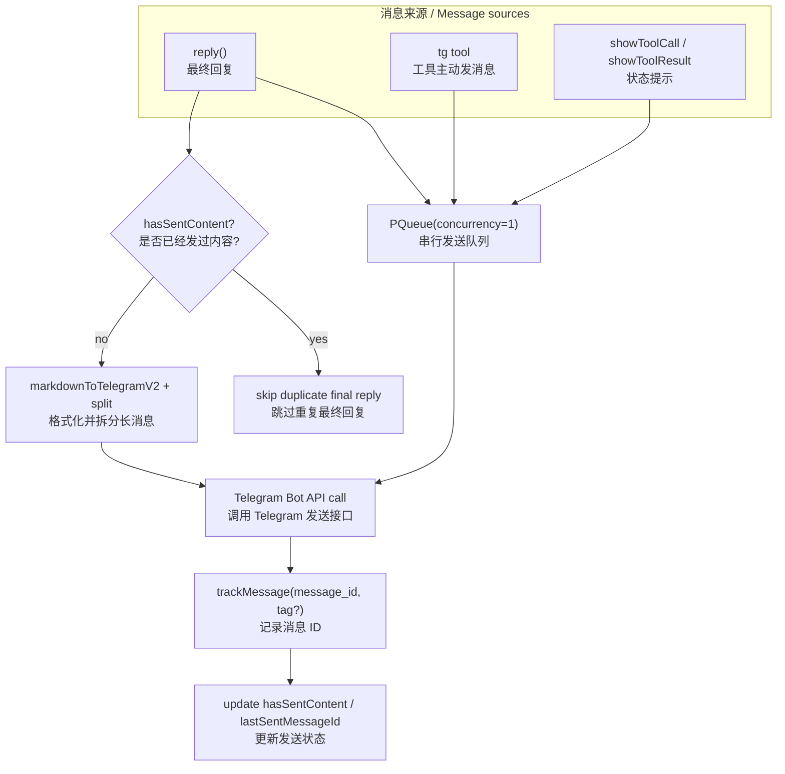

**怎么看：**

- `PQueue(1)` 保证所有出站动作按顺序执行
- `hasSentContent` 保证不会“工具发一遍 + 最终回复再发一遍”

---

## 8. Cron 调度与结果投递

**这张图在讲什么：**

- 定时任务如何从 `jobs.json` 被加载、触发、执行、投递

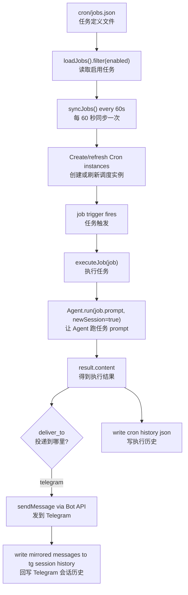

**怎么看：**

- Cron 本质上也是调用 `Agent.run()`
- 只是输入不是用户即时消息，而是 job 里的 prompt

---

## 9. 配置加载与迁移

**这张图在讲什么：**

- 配置不是简单读一个 JSON 文件，而是默认值、配置文件、环境变量三层叠加

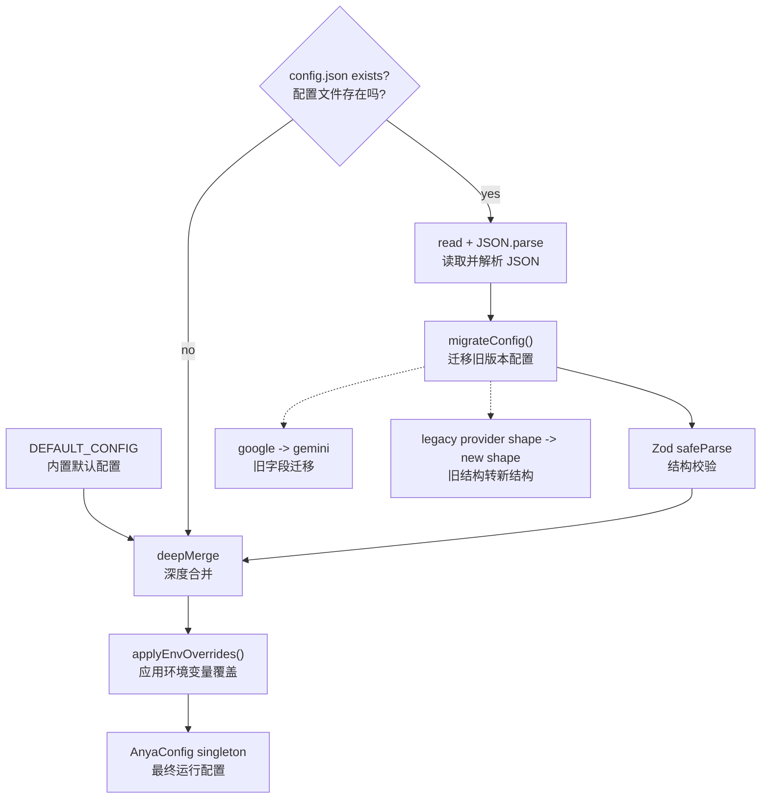

**怎么看：**

- 最终生效配置不是只看 `config.json`
- 还会被环境变量覆盖

---

## 10. 会话持久化模型

**这张图在讲什么：**

- 一轮 Agent 执行结束后，消息是怎么落到 SQLite 里的

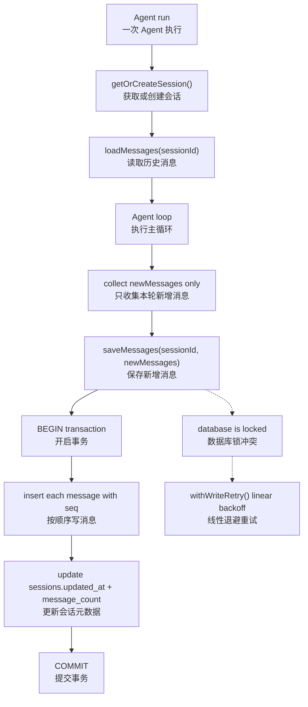

**怎么看：**

- 历史消息先读出来
- 本轮新消息单独收集
- 最后统一事务写入，避免半写半不写

---

## 11. Skill 加载与使用路径

**这张图在讲什么：**

- skills 从仓库 bundled 资源，到最终进入 prompt、被 Agent 感知和调用的路径

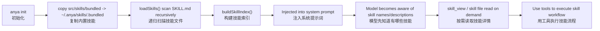

**怎么看：**

- skill 不会一上来全文塞进 prompt
- 先给模型看 skill index，真的需要时再加载细节

---

## 12. IELTS Skill Runtime 专项流程图

**这张图在讲什么：**

- Learner 在 Telegram 里发来的消息，如何进入 IELTS 相关 skill
- 单词、练习、定时任务这三大块如何和 `memory` / `db` / `tts` / `tg` 联动

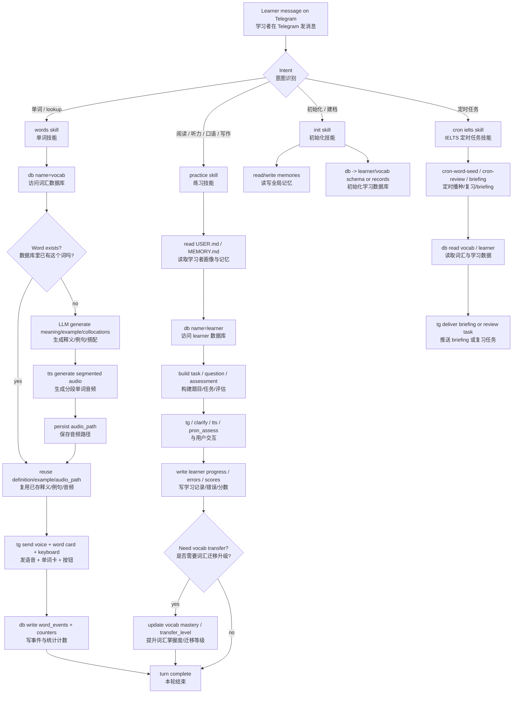

**怎么看：**

- `words` 主要围绕 `vocab.db`
- `practice` 主要围绕 `learner.db`
- 所有对用户的输出仍主要通过 `tg`、`tts`、`clarify` 等工具完成

---

## 13. 数据目录关系

**这张图在讲什么：**

- `~/.anya/` 目录内部最重要的层级关系

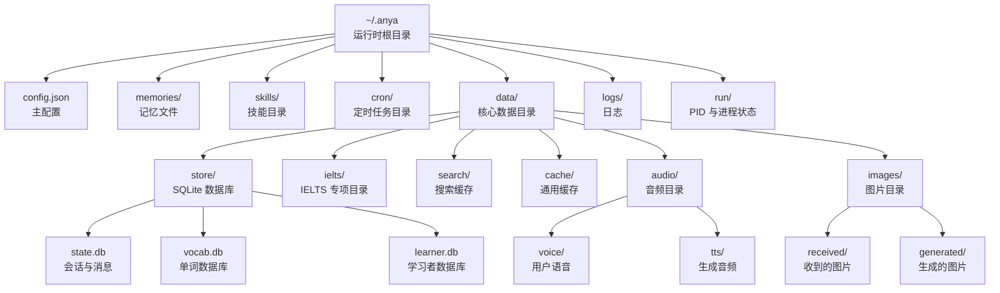

**怎么看：**

- `store/` 里是最关键的结构化数据库
- `audio/` 和 `images/` 主要是媒体与缓存

---

style OVERFLOW fill:#fff3cd
style RATE fill:#fde2e2
style COMPRESS_RETRY fill:#fff3cd

````

---

## 9. 数据流：从用户输入到最终回复

```mermaid
sequenceDiagram
  participant U as User
  participant A as Adapter (CLI/TG)
  participant AG as Agent
  participant P as Provider
  participant T as Tool Registry
  participant S as SQLite

  U->>A: Send message
  A->>AG: run(input, sessionKey)
  AG->>S: Load session + history
  AG->>AG: Build system prompt
  AG->>AG: Sanitize + truncate history

  loop ReAct Loop
    AG->>P: chat(messages, tools, config)
    P-->>AG: LLM Response

    alt Tool Calls
      AG->>A: showToolCall()
      AG->>T: dispatch(toolName, args)
      T-->>AG: Tool result
      AG->>A: showToolResult()
      Note over AG: Append to messages, continue loop
    else Text Response
      AG->>S: Save new messages
      AG->>A: reply(content)
      A-->>U: Display response
    end
  end
````

---

## 10. 目录结构与模块关系

```
src/
├── agent/                  # Agent 核心
│   ├── Agent.ts            # ReAct 循环主体
│   ├── types.ts            # Message, Adapter, ToolDefinition 等类型
│   ├── promptBuilder.ts    # System Prompt 组装
│   ├── history.ts          # 截断 + Gemini 格式清洗
│   ├── contextCompressor.ts # LLM 摘要压缩
│   ├── contextEngine.ts    # 压缩引擎接口
│   └── errorClassifier.ts  # API 错误分类
│
├── providers/              # LLM Provider 层
│   ├── base.ts             # LLMProvider 接口
│   ├── registry.ts         # model → provider 路由
│   ├── gemini.ts           # Gemini SDK 实现
│   ├── openai.ts           # OpenAI Codex SSE 实现
│   ├── openai/             # OpenAI 子模块 (retry, stream, transform)
│   └── credentialPool.ts   # 多 key 轮换池
│
├── tools/                  # 工具层
│   ├── registry.ts         # 注册 + 分发
│   ├── fileTools.ts        # 文件系统
│   ├── shellTool.ts        # 命令执行
│   ├── webSearch.ts        # Tavily 搜索
│   ├── memoryTools.ts      # 长期记忆
│   ├── skillTools.ts       # Skill CRUD
│   ├── telegramTools.ts    # TG 统一交互
│   ├── tts.ts              # 文本转语音
│   └── clarifyTools.ts     # 用户选择
│
├── adapters/               # 平台适配
│   ├── base.ts             # 抽象基类
│   ├── cli.ts              # CLI REPL
│   └── telegram/           # Telegram 适配
│       ├── TelegramAdapter.ts   # Bot 生命周期
│       ├── SessionAdapter.ts    # Per-turn 队列
│       ├── markdown.ts          # Markdown 分割/剥离
│       ├── errors.ts            # 错误格式化
│       └── types.ts             # TG 类型定义
│
├── config/                 # 配置系统
│   ├── defaults.ts         # AnyaConfig 接口 + 默认值
│   ├── schema.ts           # Zod 校验 schema
│   └── loader.ts           # 三层 merge (defaults + file + env)
│
├── storage/                # 持久化
│   ├── db.ts               # SQLite 单例 (WAL mode)
│   └── sessionStore.ts     # Session/Message CRUD
│
├── lib/                    # 基础设施
│   ├── paths.ts            # 所有文件路径常量
│   ├── logger.ts           # pino 结构化日志
│   ├── approval.ts         # 路径沙箱 + 命令审批
│   ├── auth.ts             # OpenAI OAuth Device Grant
│   ├── stt.ts              # Groq Whisper STT
│   ├── tts.ts              # Edge TTS + ffmpeg 转码
│   ├── vision.ts           # Gemini Vision
│   ├── tgFormat.ts         # Markdown → MarkdownV2
│   └── pidfile.ts          # 进程管理 PID 文件
│
├── skills/                 # Skill 系统
│   ├── loader.ts           # 加载 + 缓存 + index 生成
│   └── parser.ts           # YAML frontmatter 解析
│
├── cron/                   # 定时任务
│   ├── jobs.ts             # Job 定义 + CRUD
│   └── scheduler.ts        # croner 调度器
│
├── commands/               # CLI 命令
│   ├── chat.ts             # 交互式聊天
│   ├── init.ts             # 初始化向导
│   ├── model.ts            # 模型切换
│   ├── gateway.ts          # TG bot 进程管理
│   └── config/             # 配置子命令
│
└── index.ts                # 公共 API 导出
```
