# Anya IELTS 智能教练系统 — 终极实施蓝图 v4

> **综合 v1(宏观诊断) + v2(逐技能 Workflow) + v3(状态机与闭环) + 项目工程实际能力**，产出可直接指导开发的完整实施蓝图。
>
> 本文档从全局架构到每个功能的 Mermaid 流程图、Telegram 交互细节、Agent 工具链路，全部拉通。

---

## 0. 全局架构总览

### 0.1 系统分层架构

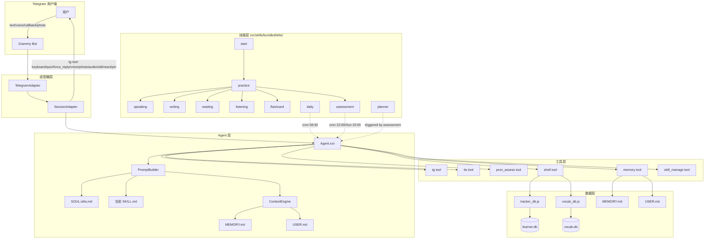

### 0.2 核心升级：10 步自适应训练流 (Universal Training Loop)

**所有训练技能（speaking/writing/reading/listening）统一遵循此闭环状态机。** 这是 v3 方案的核心，也是从"刷题机器人"升级为"教练系统"的关键。

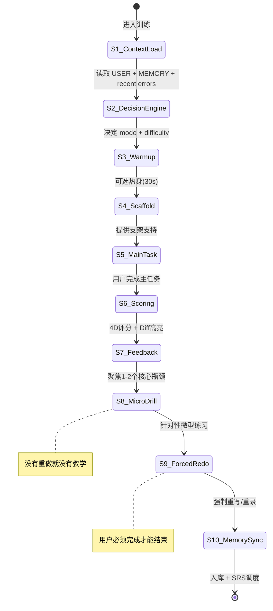

### 0.3 Telegram 交互能力矩阵

基于现有 `tg` tool 和 `SessionAdapter`，可用的 TG 原生交互：

| TG 交互类型 | Agent 工具调用 | 教学用途 |
|---|---|---|
| **Inline Keyboard** | `tg(type:"keyboard", buttons:[[...]])` | 练习选择、难度反馈、单词响应、模式切换 |
| **Quiz Poll** | `tg(type:"quiz", options:[...], correct:N)` | 语法题、词汇题、听力选择题（自动判分） |
| **Force Reply** | `tg(type:"force_reply", text:"...")` | 写作输入、听写输入、答题输入 |
| **Reply Keyboard** | `tg(type:"reply_keyboard", buttons:[[...]])` | 练习菜单、常用指令 |
| **Voice Message** | `tts(text:"...")` → 自动发送语音气泡 | 听力音频、发音示范、跟读目标音 |
| **Photo** | `tg(type:"photo", url:"...")` | 图表题（Task 1）、思维导图 |
| **Spoiler Text** | `<tg-spoiler>hidden</tg-spoiler>` | 答案隐藏、翻译延迟揭示、自测 |
| **Message Edit** | `tg(type:"edit", message_id:"tag")` | 更新进度、修改反馈 |
| **Reaction** | `tg(type:"react", emoji:"👍")` | 鼓励反馈、表情响应 |
| **Pin** | `tg(type:"pin", message_id:"tag")` | 固定本周计划、重点错误 |
| **Voice Input** | 用户发送语音 → STT 转写 + audio_path | 口语回答、跟读录音 |
| **Pronunciation Assessment** | `pron_assess(audio_path, reference_text)` | 跟读评测、口语发音分析 |

---

## 1. 初始测评 (start) — 两阶段自适应定级

### 1.1 问题诊断

当前 `start` 用 3 句写作 + 4 道选择题推导四项 band，信度极低。程序员用户极易出现"阅读6.0/口语4.0"的不均衡画像。

### 1.2 改进方案：两阶段测评

#### 阶段 A: 快速探底（5-8 分钟）

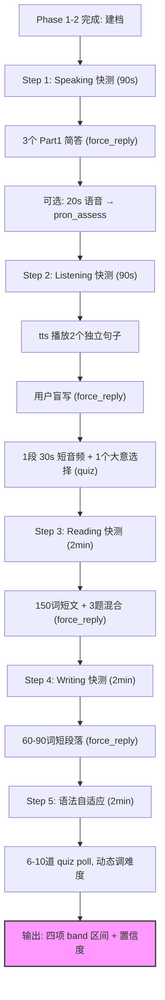

**Telegram 交互细节：**

- Step 1: `tg(type:"force_reply")` 收集文字 → 可选 `pron_assess` 分析语音
- Step 2: `tts` 播放句子 → `tg(type:"force_reply")` 收听写 → `tg(type:"quiz")` 大意题
- Step 3: `tg(type:"text")` 发长文 → `tg(type:"force_reply")` 收答案
- Step 5: 连续 `tg(type:"quiz")` 自适应推题，全对升难，错了降难

**输出格式：**

```
📊 初始评估（置信度: 中）

| 技能 | 估计区间 | 置信度 |
|---|---|---|
| Speaking | 4.5-5.0 | 低 (仅文字) |
| Listening | 5.0-5.5 | 中 |
| Reading | 5.5-6.0 | 中 |
| Writing | 5.0-5.5 | 中 |

⚠️ 前3-5次正式训练后会校准到更精确的画像
```

末尾附带 inline keyboard:

```
[KEYBOARD:
✍️ 开始写作=ck:writing | 🗣️ 开始口语=ck:speaking
📖 开始阅读=ck:reading | 🎧 开始听力=ck:listening
]
```

#### 阶段 B: 校准期（前 3-5 次正式训练）

- 每项技能完成至少 2 次正式练习后，band 区间收窄到 ±0.5
- 置信度标记为"高"，画像正式稳定
- 校准期间每次训练结束时，用 inline keyboard 收集用户感受：

```
[KEYBOARD:
😰 太难了=ck:feedback:too_hard | 👌 刚好=ck:feedback:just_right | 🥱 太简单=ck:feedback:too_easy
]
```

---

## 2. 口语 (Speaking) — 6 模式分层训练体系

### 2.1 模式矩阵总览

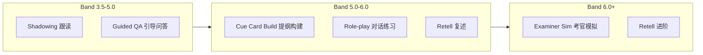

| 模式 | Band | 支架程度 | TG 交互核心 | Agent 工具 |
|---|---|---|---|---|
| **Shadowing** | < 5.0 | 极高 | voice + inline keyboard | `tts` + `pron_assess` |
| **Guided QA** | 4.5-5.5 | 高 | force_reply + keyboard | `tts` |
| **Cue Card Build** | 5.0-6.0 | 中 | force_reply + keyboard | `tts` |
| **Role-play** | 4.5-6.0 | 中 | 多轮 force_reply | `tts` |
| **Retell** | all | 按材料调 | voice + force_reply | `tts` + `pron_assess` |
| **Examiner Sim** | 5.5+ | 低/零 | voice + keyboard (追问) | `tts` + `pron_assess` |

### 2.2 Shadowing 跟读 — 详细 Workflow

**核心工具链**：`tts` → 用户语音回复 → `pron_assess(audio_path, reference_text)` → 反馈 → 再跟读

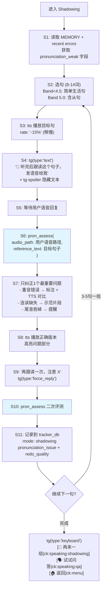

**pron_assess 结果利用：**

```json
{
  "scores": {
    "accuracy": 78,
    "fluency": 65,
    "completeness": 90,
    "prosody": 55
  },
  "words": [
    { "word": "usually", "accuracy": 45, "error": "Mispronunciation" },
    { "word": "weekends", "accuracy": 82 }
  ]
}
```

Agent 根据 `words` 中 accuracy 最低的词定位问题，给出针对性 TTS 对比。

### 2.3 Guided QA 引导问答 — 详细 Workflow

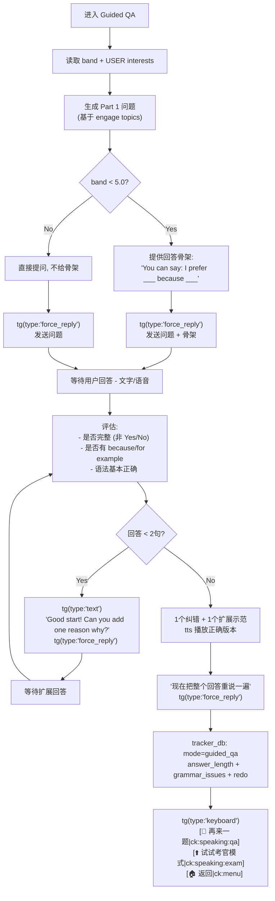

### 2.4 Examiner Sim 考官模拟 — 增强版 Workflow (6.5+ 冲刺)

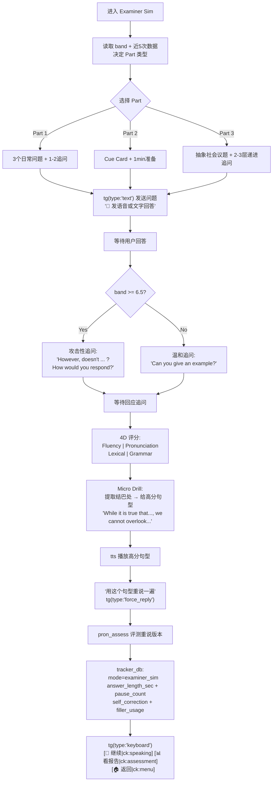

### 2.5 Speaking 模式自动选择逻辑

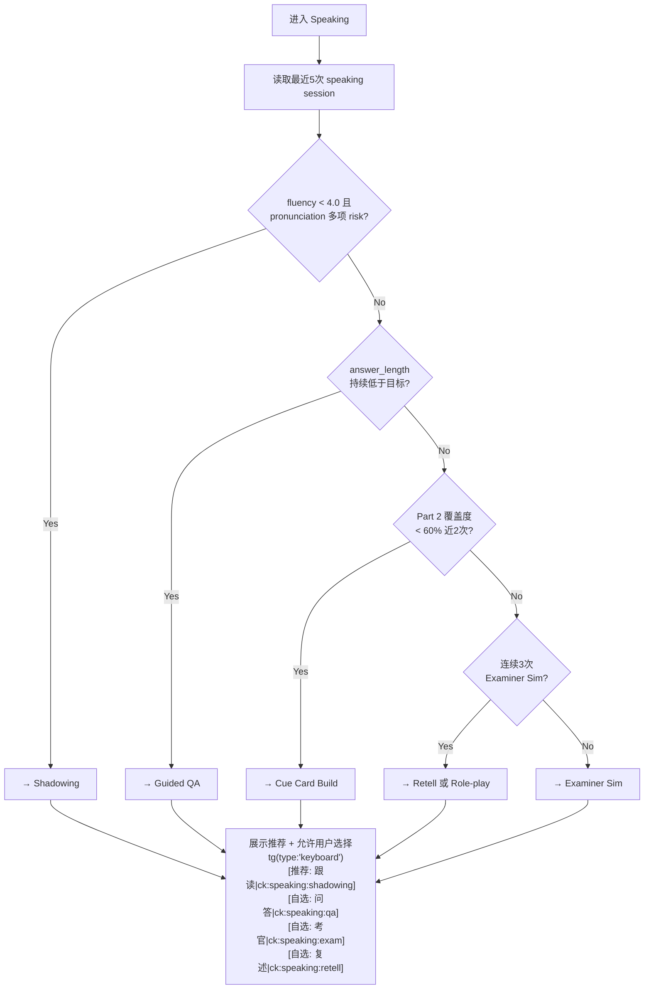

### 2.6 难度反馈收集 (所有 Speaking 模式通用)

每次练习结束后，通过 inline keyboard 收集用户对难度的感受：

```
tg(type:"keyboard", text:"这次练习感觉怎么样？",
   buttons:[
     ["😰 太难了|ck:feedback:too_hard", "👌 刚好|ck:feedback:just_right", "🥱 太简单|ck:feedback:too_easy"],
     ["🗣️ 继续口语|ck:speaking", "🏠 返回菜单|ck:menu"]
   ])
```

回调处理：
- `ck:feedback:too_hard` → 下次降低一个难度档 + 增加支架
- `ck:feedback:just_right` → 保持当前难度
- `ck:feedback:too_easy` → 下次升高一个难度档 + 减少支架
- 写入 `tracker_db` 的 `difficulty_feedback` 字段

---

## 3. 听力 (Listening) — 5 模式解码重构体系

### 3.1 模式矩阵总览

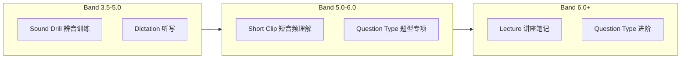

| 模式 | Band | 音频特征 | TG 交互核心 | Agent 工具 |
|---|---|---|---|---|
| **Sound Drill** | < 5.0 | 单词/短语对比 | quiz poll + tts 对比 | `tts` |
| **Dictation** | 4.5-6.0 | 8-25词单句 | force_reply + diff 高亮 | `tts` |
| **Short Clip** | 5.0-6.0 | 40-80s 对话 | force_reply + spoiler | `tts` |
| **Question Type** | all | 按题型设计 | quiz + force_reply | `tts` |
| **Lecture** | 6.0+ | 90-180s 学术 | force_reply + keyboard | `tts` |

### 3.2 Sound Drill 辨音训练 — 详细 Workflow

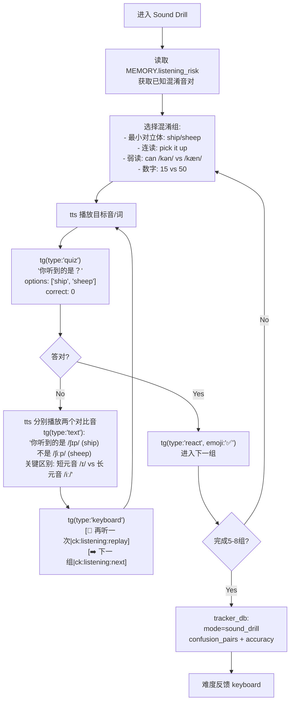

### 3.3 Dictation 听写 — 详细 Workflow

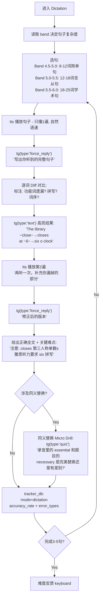

### 3.4 Short Clip 增强版 — 两遍听 + 错因分析

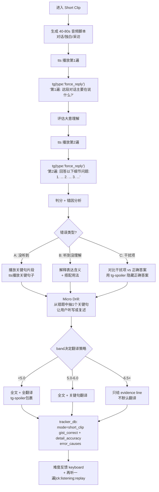

### 3.5 翻译支持分级策略

| Band | Transcript | 翻译 | 实现方式 |
|---|---|---|---|
| 4.0-5.0 | 全文 | 全文中文翻译 | `<tg-spoiler>全文+翻译</tg-spoiler>` |
| 5.5-6.0 | 全文 | 只翻译关键句 + 生词释义 | 关键句用 `<tg-spoiler>` |
| 6.5+ | 标注 evidence line | 不默认翻译，按需请求 | inline keyboard: `[显示翻译\|ck:show_translation]` |

---

## 4. 阅读 (Reading) — 提速与长难句外科手术

### 4.1 模式矩阵

| 模式 | 适用场景 | 核心交互 |
|---|---|---|
| **Flash-Skimming** | 逐字翻译/阅读极慢 | 限时展示 → 隐藏 → quiz |
| **Sentence Anatomy** | 长难句崩溃/TFNG错位 | 标注主谓 → 苏格拉底追问 |
| **Standard Practice** | 常规训练 | 300-600词 + 混合题型 |
| **Timed Exam** | 备考冲刺 | 900词 + 15分钟限时 |

### 4.2 Flash-Skimming 闪卡略读 — 详细 Workflow

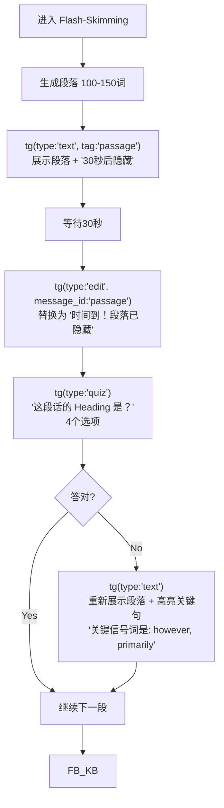

### 4.3 Sentence Anatomy 长难句解剖 — 详细 Workflow

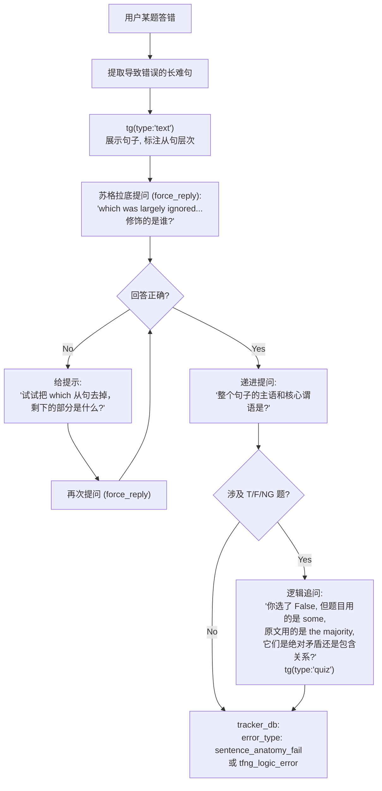

### 4.4 Standard Practice 增强版 Workflow

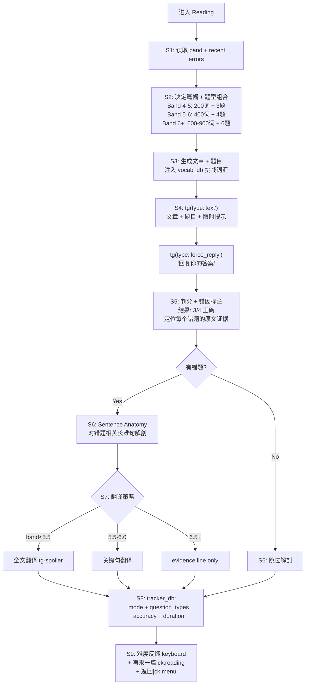

---

## 5. 写作 (Writing) — 支架与重写闭环

### 5.1 模式矩阵

| 阶段 | 模式 | 适用场景 | TG 交互 |
|---|---|---|---|
| **冷启动** | Brainstorming 思路脑暴 | 拿到题目大脑空白 | inline keyboard 选论点 |
| **段落微操** | TEEL Drill | 逻辑散乱/不会举例 | 分步 force_reply |
| **完整写作** | Full Task + Forced Rewrite | 常规训练 | force_reply + 重写循环 |

### 5.2 完整写作 Workflow（含 Brainstorming + Forced Rewrite）

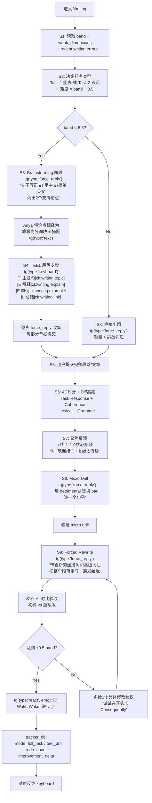

### 5.3 Task 1 图表题特殊处理

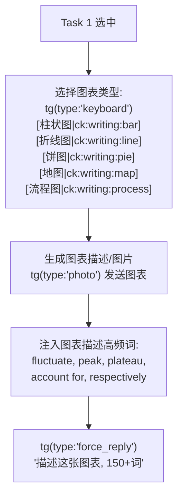

---

## 6. 单词 (Flashcard) — 生产性迁移体系

### 6.1 4 级迁移模型

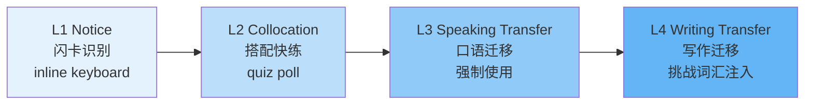

### 6.2 单词卡增强 Workflow

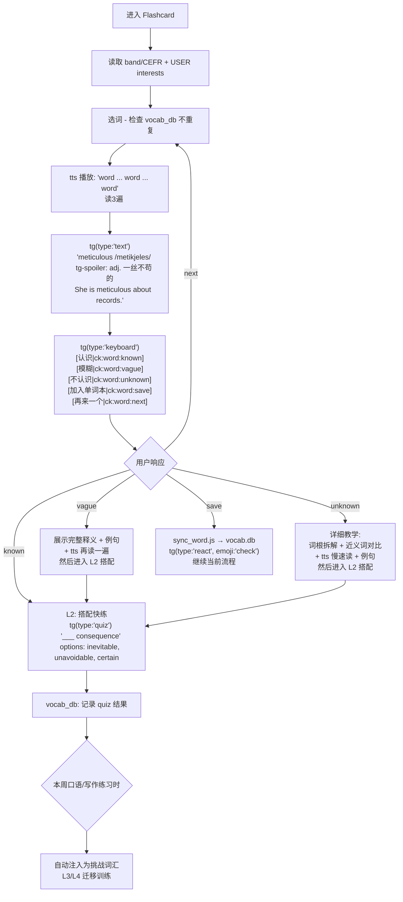

### 6.3 随时加词功能

**用户在任何对话中发送一个英文单词** → SOUL.md 路由匹配 → 触发隐式查词 + 加入单词本:

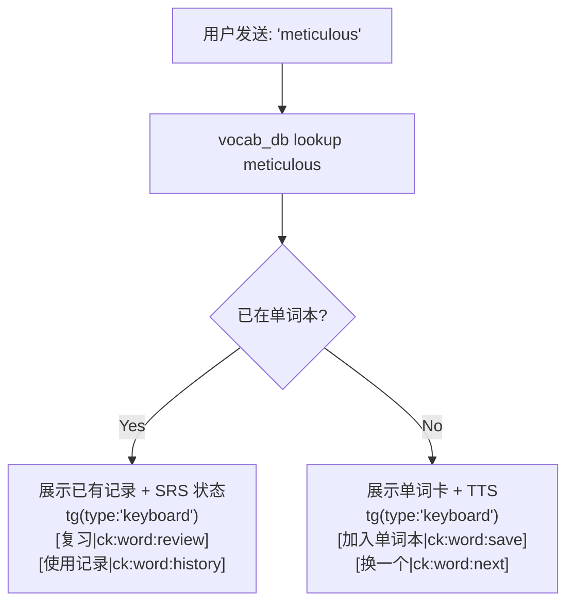

---

## 7. 难度反馈与自适应系统

### 7.1 统一难度反馈机制

**所有训练结束后**都附带难度反馈 inline keyboard，这是让系统真正"自适应"的关键：

```mermaid
flowchart TD
    END[训练结束] --> FB_KB["tg(type:'keyboard')
    [太难了|ck:feedback:too_hard]
    [刚好|ck:feedback:just_right]
    [太简单|ck:feedback:too_easy]"]

    FB_KB --> HARD["ck:feedback:too_hard"]
    FB_KB --> OK["ck:feedback:just_right"]
    FB_KB --> EASY["ck:feedback:too_easy"]

    HARD --> ADJ_DOWN["tracker_db: difficulty_feedback=too_hard
    下次: 降低难度参数
    - 语速降低 / 篇幅缩短
    - 增加支架 / 给骨架
    - 切换到低阶模式"]

    OK --> KEEP["保持当前难度
    继续轮换模式"]

    EASY --> ADJ_UP["tracker_db: difficulty_feedback=too_easy
    下次: 提高难度参数
    - 语速加快 / 篇幅增长
    - 减少支架
    - 切换到高阶模式"]
```

### 7.2 多维度难度调节矩阵

| 维度 | Speaking | Listening | Reading | Writing |
|---|---|---|---|---|
| **话题/内容** | 生活→社会→抽象 | 生活→学术 | 150词→900词 | 简单议题→抽象议题 |
| **时间压力** | 无→1min准备 | 自然语速→快速 | 无限→15min限时 | 无限→40min限时 |
| **支架程度** | 给骨架→给关键词→不给 | 2遍听→1遍听 | 给翻译→关键词→不给 | 脑暴+TEEL→直接写 |
| **追问/题量** | 0→1→3 | 1-3题→5-8题 | 3题→6题 | 无→段落重写 |
| **口音/复杂度** | - | 标准→英式→混合口音 | 简单句→长难句密集 | Task 2→Task 1混合 |

---

## 8. 评估与复习系统

### 8.1 三级评估体系

```mermaid
flowchart TD
    subgraph LIGHT["Light 每日22:00 静默"]
        L1[查询今日 samples] --> L2[EMA 更新 band]
        L2 --> L3[更新 Top Errors]
        L3 --> L4[写入 MEMORY.md]
    end

    subgraph DEEP["Deep 周日20:00 报告"]
        D1[查询7天数据] --> D2[全维度分析]
        D2 --> D3[更新所有 MEMORY 字段]
        D3 --> D4[触发 planner 生成周计划]
        D4 --> D5["发送周报 + pin"]
    end

    subgraph DEMAND["On-Demand 用户触发"]
        O1[4项快速测试] --> O2[对比历史数据]
        O2 --> O3[生成进步报告]
        O3 --> O4["inline keyboard:
        [详细报告|ck:report:detail]
        [本周计划|ck:report:plan]"]
    end
```

### 8.2 周报交互设计

```
本周学习报告 (4.7 - 4.13)

| 技能 | 上周 | 本周 | 趋势 |
|---|---|---|---|
| Speaking | 5.0 | 5.5 | up |
| Listening | 5.5 | 5.5 | same |
| Reading | 5.5 | 6.0 | up |
| Writing | 5.0 | 5.0 | same |

本周完成 12 次练习，连续打卡 7 天
最大进步: Speaking fluency
持续弱项: writing cohesion

[KEYBOARD:
下周计划=ck:report:plan | 详细数据=ck:report:detail
返回=ck:menu
]
```

---

## 9. 数据层扩展方案

### 9.1 tracker_db.js samples 表扩展

当前字段保留，新增以下字段：

| 新字段 | 类型 | 用途 |
|---|---|---|
| `mode` | TEXT | shadowing / dictation / guided_qa / examiner_sim / teel_drill / full_task / ... |
| `question_type` | TEXT | TFNG / form_completion / cue_card / task1_process / ... |
| `duration_sec` | INTEGER | 实际答题耗时（秒） |
| `redo_count` | INTEGER | 重写/重录次数（没有 redo 的 sample 权重降低） |
| `support_level` | TEXT | high / medium / low / none（支架程度） |
| `difficulty_feedback` | TEXT | too_hard / just_right / too_easy（用户反馈） |
| `audio_duration_sec` | INTEGER | 听力音频时长 |
| `response_length_words` | INTEGER | 用户回答字数 |
| `accent` | TEXT | standard / british / australian / mixed |
| `speaker_count` | INTEGER | 听力说话人数 |

### 9.2 errors 表扩展 Error Taxonomy

```
Speaking:
  pronunciation_stress, pronunciation_vowel, pronunciation_consonant,
  hesitation_breakdown, filler_overuse, part3_abstraction_gap,
  answer_too_short, self_correction_fail

Listening:
  minimal_pair_confusion, function_word_miss, paraphrase_miss,
  distractor_trap, spelling_error, missed_plural_s,
  number_confusion, connected_speech_fail

Reading:
  tfng_logic_error, heading_mismatch, sentence_anatomy_fail,
  detail_location_fail, speed_too_slow, inference_error

Writing:
  cohesion_missing, topic_sentence_weak, example_vague,
  word_choice_basic, task_response_off_topic, paragraph_structure_weak
```

### 9.3 新增回调路由 (SOUL.ielts.md 扩展)

```
难度反馈:
  ck:feedback:too_hard    → 记录 + 调难度
  ck:feedback:just_right  → 记录
  ck:feedback:too_easy    → 记录 + 调难度

Speaking 模式选择:
  ck:speaking:shadowing   → speaking (mode=shadowing)
  ck:speaking:qa          → speaking (mode=guided_qa)
  ck:speaking:exam        → speaking (mode=examiner_sim)
  ck:speaking:retell      → speaking (mode=retell)
  ck:speaking:roleplay    → speaking (mode=roleplay)

Listening 模式选择:
  ck:listening:sound      → listening (mode=sound_drill)
  ck:listening:dictation  → listening (mode=dictation)
  ck:listening:clip       → listening (mode=short_clip)
  ck:listening:type       → listening (mode=question_type)

Reading 模式选择:
  ck:reading:skim         → reading (mode=flash_skimming)
  ck:reading:anatomy      → reading (mode=sentence_anatomy)

Writing 模式选择:
  ck:writing:brain        → writing (mode=brainstorming)
  ck:writing:teel         → writing (mode=teel_drill)
  ck:writing:topic        → writing TEEL step T
  ck:writing:explain      → writing TEEL step E1
  ck:writing:example      → writing TEEL step E2
  ck:writing:link         → writing TEEL step L

单词扩展:
  ck:word:save            → flashcard (sync to db)
  ck:word:review          → flashcard (SRS review)
  ck:word:history         → flashcard (usage history)

其他:
  ck:show_translation     → 显示翻译
  ck:report:detail        → assessment (detailed view)
  ck:report:plan          → planner (show plan)
```

---

## 10. 实施优先级与阶段规划

### Phase 1: 核心闭环 (最高优先级)

**目标：让每次训练都有"重做"环节，形成最小闭环**

1. 统一训练流模板：在所有 SKILL.md 中加入 S8(Micro Drill) + S9(Forced Redo) 步骤
2. 难度反馈 inline keyboard：所有训练结束后附带 `ck:feedback:*` 按钮
3. tracker_db.js 扩展：新增 `mode`, `redo_count`, `difficulty_feedback` 字段
4. SOUL.ielts.md 路由扩展：新增所有 `ck:feedback:*` 回调

### Phase 2: Speaking 多模式 (高优先级)

**目标：口语从单一 Part 1/2/3 升级为 6 模式体系**

1. Shadowing 模式实现（`tts` + `pron_assess` 闭环）
2. Guided QA 模式实现（支架 + 扩展引导）
3. 模式自动选择逻辑
4. 模式选择 inline keyboard

### Phase 3: Listening 多模式 (高优先级)

**目标：听力从"泛听做题"升级为"解码重构"**

1. Sound Drill 辨音训练（quiz poll 对比）
2. Dictation 听写（Diff 高亮 + 二次修正）
3. Short Clip 增强（两遍听 + 错因分析）
4. 翻译分级策略

### Phase 4: 写作增强 + 阅读增强 (中优先级)

1. Brainstorming 前置阶段
2. TEEL 段落支架
3. Forced Rewrite 循环
4. Reading: Flash-Skimming + Sentence Anatomy

### Phase 5: 词汇迁移 + 评估升级 (中优先级)

1. 单词 4 级迁移模型
2. 随时加词功能增强
3. 初始测评两阶段改造
4. 周报交互升级

### Phase 6: 精细化打磨 (后续迭代)

1. 多维度难度调节矩阵全面落地
2. 状态机引擎（AWAITING_REWRITE 等状态拦截）
3. 口音多样化（英/澳/印）
4. Task 1 图表题图片生成
5. Role-play 场景库
6. SRS 复习调度与跨技能联动
