# Telegram 消息链路完整分析

> 本文档覆盖 Anya Telegram Bot 从消息接收到回复发送的完整生命周期。

---

## 1. 总体架构

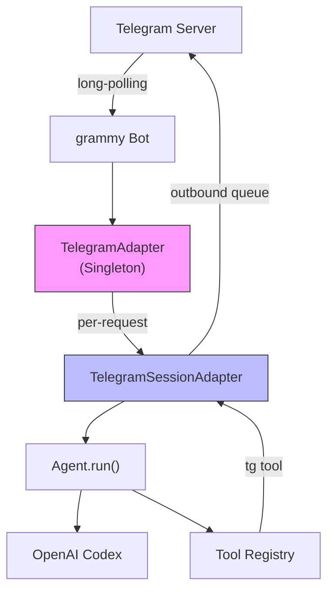

**两层 Adapter 设计**：

| 层 | 类 | 生命周期 | 职责 |
|---|---|---------|------|
| Singleton | `TelegramAdapter` | 进程生命周期 | Bot 实例、命令注册、消息路由、共享状态 |
| Per-request | `TelegramSessionAdapter` | 单次用户消息 | Adapter 接口实现、出站队列、状态窗口 |

---

## 2. 启动流程

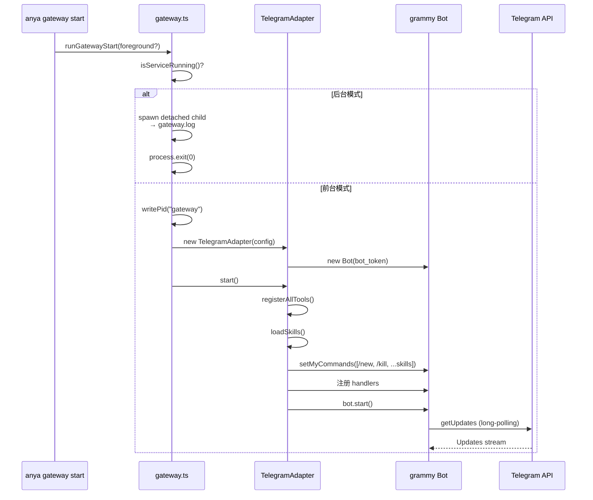

**Handler 注册顺序**（优先级从高到低）：
1. `/start` — 欢迎消息
2. `/new` — 创建新会话
3. `/kill` — 强制停止 + 清空
4. 动态 skill commands（如 `/init`, `/practice`）
5. `message:text` — 文本消息
6. `message:voice` — 语音消息
7. `message:photo` — 图片消息
8. `callback_query:data` — 按钮回调

---

## 3. 文本消息处理流程

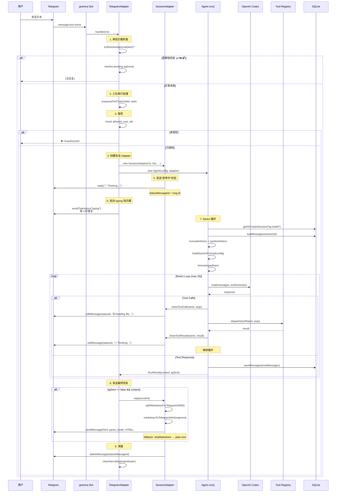

---

## 4. 语音消息处理流程

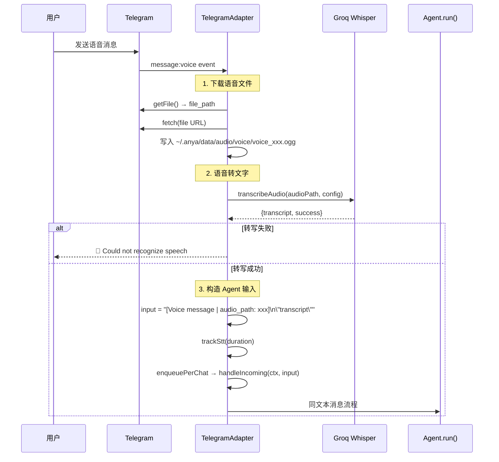

**关键设计**：输入中嵌入 `audio_path`，使下游 `pron_assess` 工具可以直接引用原始音频文件。

---

## 5. 图片消息处理流程

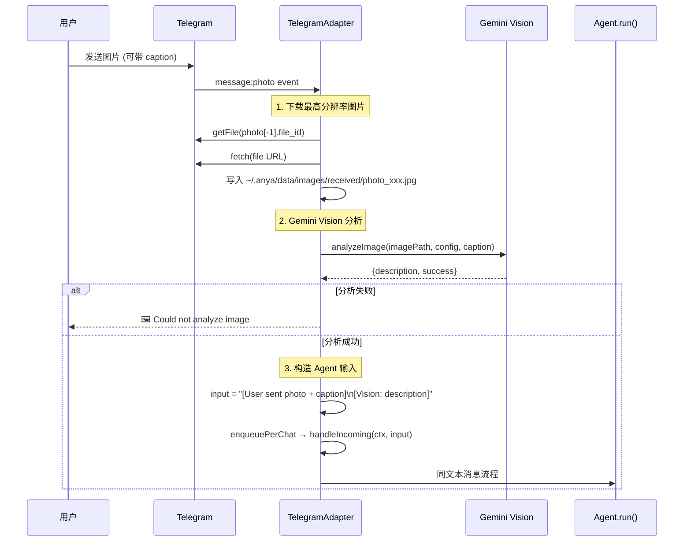

**注意**：图片不会被删除（保留审计记录），与语音文件处理不同。

---

## 6. Callback Query 处理流程

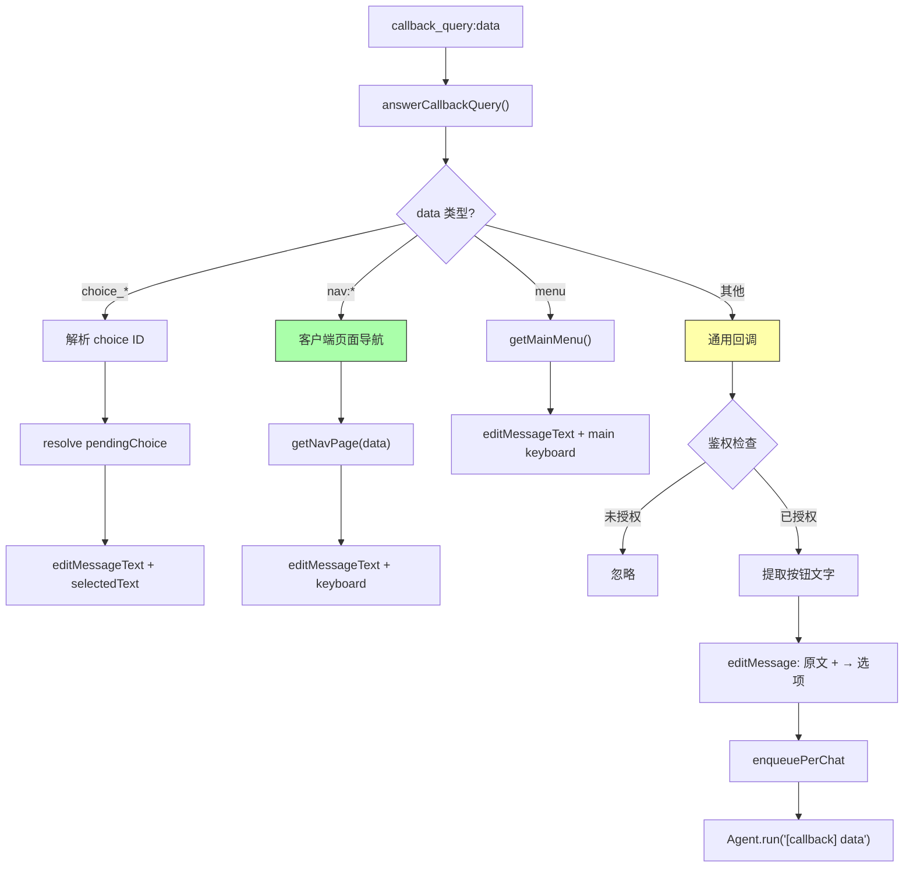

**三种回调类型**：

| 前缀 | 处理方式 | 是否触发 Agent |
|------|---------|--------------|
| `choice_*` | 解析 pendingChoice promise | ❌ |
| `nav:*` | 客户端翻页（skillMenu.ts） | ❌ |
| 其他 | 作为 `[callback] data` 送入 Agent | ✅ |

---

## 7. 出站消息队列

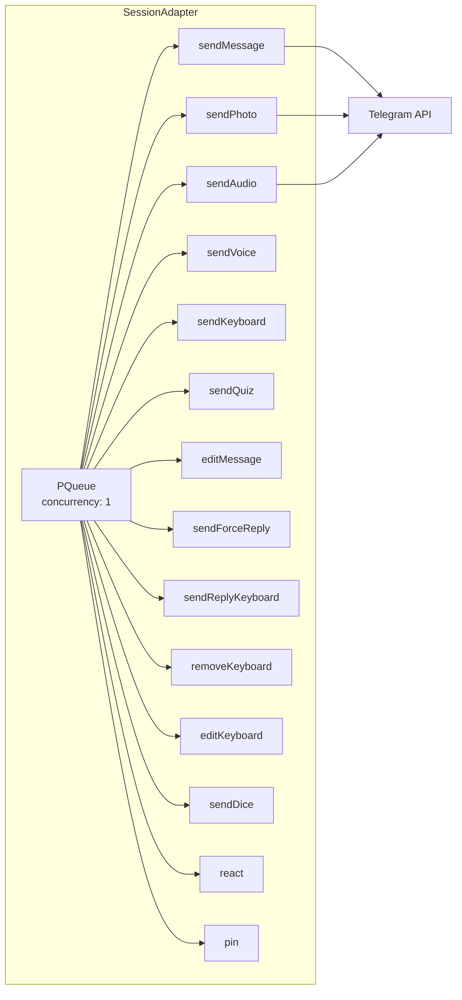

**设计要点**：

- **PQueue concurrency=1** — 所有 TG API 调用严格串行，保证消息顺序
- **Smart Reply** — 本轮第一条消息自动 reply_to 用户原始消息，后续不 reply（避免回复链刷屏）
- **hasSentContent 去重** — tg tool 发过内容后，`reply()` 不再重复发送
- **HTML fallback** — parse_mode=HTML 失败自动降级为 stripMarkdown 纯文本

---

## 8. 状态窗口 (Status Window)

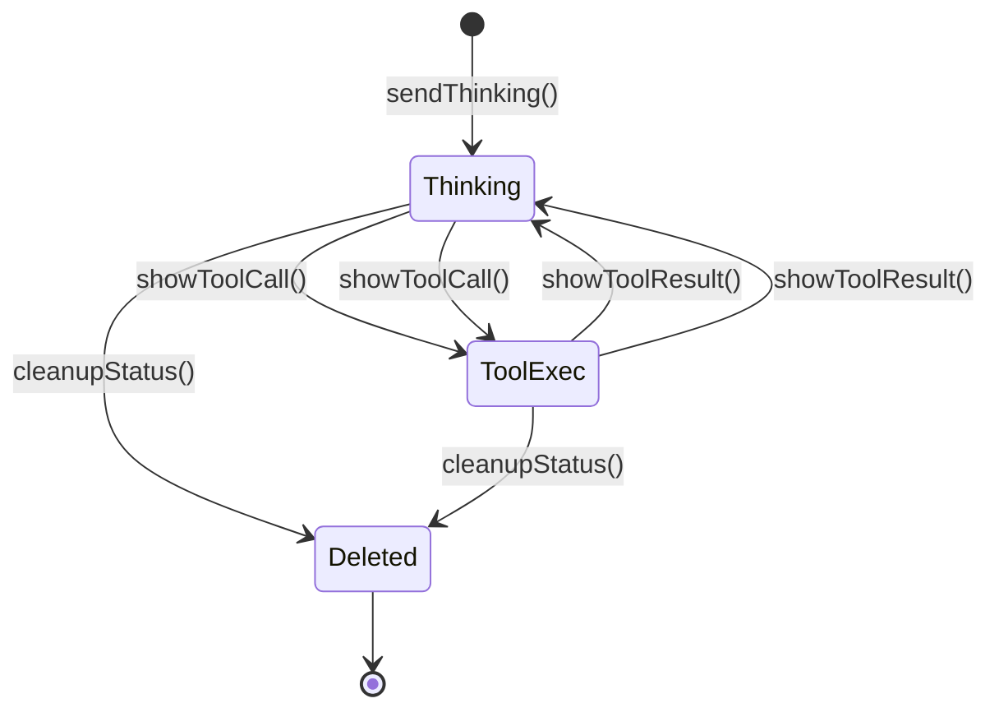

**始终只有一条状态消息**，通过 `editMessageText` 原地更新：

| 阶段 | 显示内容 |
|------|---------|
| 初始 | `🤔 Thinking...` |
| read_file | `⏳ 📄 Reading file...` |
| shell | `⏳ 💻 Running command...` |
| web_search | `⏳ 🔍 Searching...` |
| tts | `⏳ 🔊 Generating audio...` |
| image_gen | `⏳ 🖼️ Generating image...` |
| db | `⏳ 🗄️ Querying database...` |
| 工具完成 | `🤔 Thinking...`（重置） |
| 最终 | 删除状态消息 |

---

## 9. tg Tool 统一调度

Agent 通过 `tg` 工具与 Telegram 交互，所有 14 种操作合并为单个工具声明：

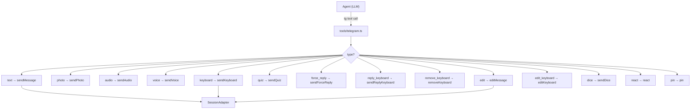

**Tag 系统**：工具可通过 `tag` 参数标记消息，后续用 tag 引用编辑/pin/react，无需记住 message_id。

---

## 10. Markdown → Telegram HTML 转换

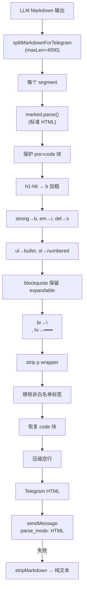

**Telegram 白名单标签**：`b`, `i`, `u`, `s`, `code`, `pre`, `a`, `blockquote`, `tg-spoiler`, `tg-emoji`

---

## 11. Per-Chat 串行队列

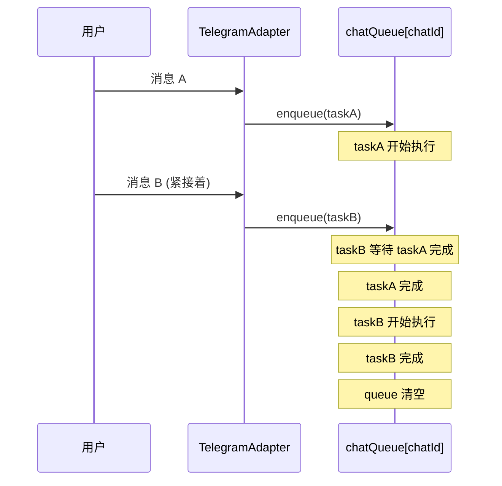

**为什么需要**：同一个 chat 的两条消息如果并发执行 `Agent.run()`，会竞争同一个 `tg:<chatId>` session 的历史记录，导致消息交错和状态窗口冲突。

---

## 12. 审批流程 (Shell / File)

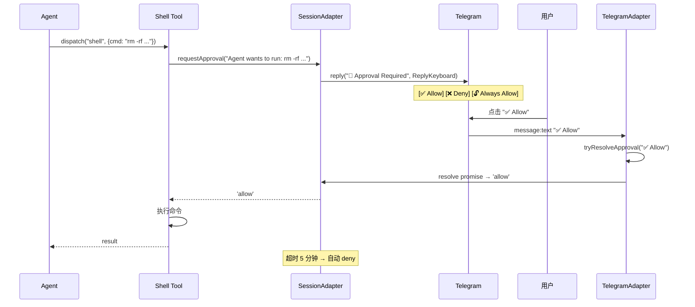

---

## 13. Skill Menu 导航

```mermaid
flowchart TD
    SKILL["Skill SKILL.md<br/>command: true"] -->|"/init"| CMD["Bot command handler"]
    CMD --> NEW["createSession()"]
    NEW --> AGENT["Agent.run('[/command: init]')"]
    AGENT -->|tg keyboard| MENU["InlineKeyboard 菜单"]

    MENU -->|"nav:writing"| NAV["skillMenu.ts"]
    NAV --> JSON["templates/menu.json"]
    JSON --> PAGE["getNavPage()"]
    PAGE --> EDIT["editMessageText + 新 keyboard"]
    Note over EDIT: 纯客户端翻页，无 Agent 调用

    MENU -->|"start_writing"| CB["callback_query"]
    CB --> AGENT2["Agent.run('[callback] start_writing')"]
    Note over AGENT2: 需要 Agent 处理的回调
```

**menu.json 格式**：
```json
{
  "main": {
    "text": "🎯 Pick a skill",
    "buttons": [
      ["📝 Writing|nav:writing", "🗣️ Speaking|nav:speaking"],
      ["📖 Reading|nav:reading", "🎧 Listening|nav:listening"]
    ]
  },
  "writing": {
    "text": "📝 Writing Practice",
    "buttons": [
      ["Brainstorm|start_brainstorm", "Full Task|start_full_task"],
      ["← Back|nav:main"]
    ]
  }
}
```

---

## 14. 错误处理

```mermaid
flowchart TD
    ERR["Agent.run() 抛异常"] --> FORMAT["formatTgError(error)"]
    FORMAT --> CHECK{错误类型?}

    CHECK -->|"429/RESOURCE_EXHAUSTED"| RATE["⚠️ API rate limit reached"]
    CHECK -->|"401/403/API_KEY_INVALID"| AUTH["⚠️ API key invalid or expired"]
    CHECK -->|"500/502/503"| SERVER["⚠️ API service unavailable"]
    CHECK -->|其他| GENERIC["⚠️ 截断消息 (200 chars)"]

    RATE --> SEND["ctx.reply(message)"]
    AUTH --> SEND
    SERVER --> SEND
    GENERIC --> SEND

    Note over SEND: link_preview disabled
```

**HTML 发送 fallback 链**：
1. `sendMessage(html, parse_mode: HTML)` — 首选
2. `sendMessage(stripMarkdown(text))` — HTML 解析失败
3. 日志记录 `tg_reply_dropped` — 最终失败

---

## 15. 关键文件索引

| 文件 | 行数 | 职责 |
|------|------|------|
| [TelegramAdapter.ts](../src/adapters/telegram/TelegramAdapter.ts) | 484 | Bot 生命周期、命令注册、消息路由 |
| [SessionAdapter.ts](../src/adapters/telegram/SessionAdapter.ts) | 568 | 每请求 Adapter、出站队列、状态窗口 |
| [telegram.ts (tool)](../src/tools/telegram.ts) | 247 | 统一 tg 工具（14 种 type） |
| [telegram.ts (entry)](../src/adapters/telegram.ts) | 33 | 公共导出 |
| [skillMenu.ts](../src/adapters/telegram/skillMenu.ts) | 146 | 多页 InlineKeyboard 导航 |
| [markdown.ts](../src/adapters/telegram/markdown.ts) | 80 | Markdown 分割与剥离 |
| [tgFormat.ts](../src/lib/tgFormat.ts) | 95 | Markdown → Telegram HTML |
| [errors.ts](../src/adapters/telegram/errors.ts) | 35 | 错误格式化 + typing 指示器 |
| [types.ts](../src/adapters/telegram/types.ts) | 26 | 共享类型定义 |
| [gateway.ts](../src/commands/gateway.ts) | 154 | 进程管理（start/stop/restart/logs） |
